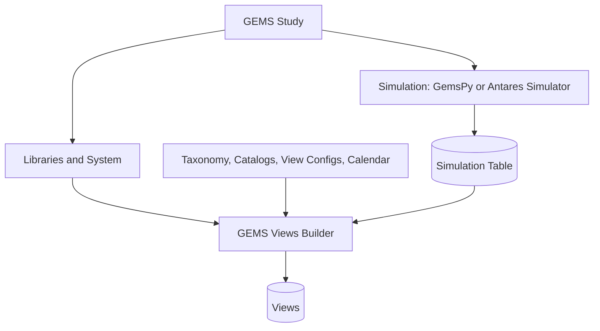

<div align="center">


# GEMS Views Builder

**Turn GEMS Simulation Tables into business ready Views.**

[](https://pypi.org/project/gems-views-builder/)
[](https://pypi.org/project/gems-views-builder/)
[](https://opensource.org/licenses/MPL-2.0)
[](https://gems-viewsbuilder.readthedocs.io/en/latest/)
<br>
[](https://github.com/AntaresSimulatorTeam/GEMS-ViewsBuilder/actions/workflows/tests.yml)
[](https://github.com/AntaresSimulatorTeam/GEMS-ViewsBuilder/actions/workflows/code-quality.yml)
[](https://github.com/astral-sh/ruff)
[](https://mypy-lang.org/)
[](https://github.com/astral-sh/uv)

[**Documentation**](https://gems-viewsbuilder.readthedocs.io/en/latest/) ·
[**Getting started**](https://gems-viewsbuilder.readthedocs.io/en/latest/getting-started/) ·
[**Examples**](https://gems-viewsbuilder.readthedocs.io/en/latest/examples/simple-setups/) ·
[**Changelog**](CHANGELOG.md) ·
[**Report an issue**](https://github.com/AntaresSimulatorTeam/GEMS-ViewsBuilder/issues)

</div>

---

**GEMS Views Builder** turns the results of a [GEMS](https://gems-energy.readthedocs.io/en/latest/) simulation into **Views**: tables of metrics aggregated per location, time granularity and scenario, ready to analyse or plot.

A View answers a business question on top of a Simulation Table, for example *"hourly production per area"* or *"yearly unsupplied energy per country, averaged over scenarios"*.<br> GVB works with any Simulation Table that follows the GEMS format, whether it was written by [GemsPy](https://github.com/AntaresSimulatorTeam/GemsPy) or by the [Antares Simulator](https://antares-simulator.org/) Modeler.



## 📦 Installation

```bash
pip install gems-views-builder
```

## 🚀 Quickstart

```bash
gems-views-builder \
  --system            path/to/system.yml \
  --libraries-dir     path/to/libraries \
  --taxonomy          path/to/taxonomy.yml \
  --catalogs-dir      path/to/catalogs \
  --view-configs      "path/to/view_configs/*.yml" \
  --calendar          path/to/calendar.csv \
  --simulation-tables "path/to/results/st-x-mc-*.parquet" \
  --output-dir        views_out
```

Then open the result with any Parquet reader:

```python
import polars as pl

view = pl.read_parquet("views_out/*.parquet")
print(view.head())
```

Run `gems-views-builder --help` for every option, or see the [Command line](https://gems-viewsbuilder.readthedocs.io/en/latest/user-guide/command-line/) page.

## 🧩 Inputs and outputs

| Input | What it is |
|---|---|
| [System](https://gems-energy.readthedocs.io/en/latest/user-guide/input-files/system/) and [model libraries](https://gems-energy.readthedocs.io/en/latest/user-guide/input-files/library/) | The GEMS study that was simulated. |
| [Simulation Tables](https://gems-energy.readthedocs.io/en/latest/user-guide/outputs/simulation-table/) | One or several simulation results, consistent with the system. |
| [Taxonomy](https://gems-energy.readthedocs.io/en/latest/user-guide/input-files/taxonomy/) | Groups the models of the study into categories (*generator*, *load*, *area*, ...). |
| [Catalogs](https://gems-energy.readthedocs.io/en/latest/user-guide/input-files/catalog/) | Define the **metrics** computed from those categories. |
| [View configs](https://gems-energy.readthedocs.io/en/latest/user-guide/input-files/view-config/) | Select the metrics, the location category and the aggregation patterns. |
| Calendar | Maps simulation time indices to dates (CSV). |

The output is one [View](https://gems-energy.readthedocs.io/en/latest/user-guide/outputs/views/) per view config and aggregation pattern, with one row per metric, location, date and scenario (or scenario statistic).

## 🛠️ Development

```bash
git clone https://github.com/AntaresSimulatorTeam/GEMS-ViewsBuilder.git
```
```bash
cd GEMS-ViewsBuilder
uv sync
uv run pre-commit install
```

Run mypy and Ruff:

```bash
uv run pre-commit run --all-files
```

Build the documentation locally:

```bash
uv sync --extra doc
uv run mkdocs serve
```

## 📄 License

GEMS-ViewsBuilder is developed by [RTE](https://www.rte-france.com) and distributed under the [Mozilla Public License 2.0](LICENSE). The list of authors is in [AUTHORS.txt](AUTHORS.txt).
