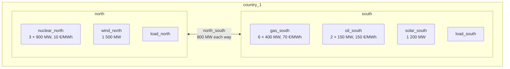

# Two areas, from simulation to Views

This example goes through the whole chain on a study closer to a real one than [Simple setups](simple-setups.md): two areas joined by a link, built with the GEMS [Antares legacy library](https://github.com/AntaresSimulatorTeam/GEMS/blob/main/libraries/antares_legacy_models.yml), simulated with [GemsPy](https://github.com/AntaresSimulatorTeam/GemsPy), and turned into Views by GVB.

Compared with Simple setups, it shows:

| Feature | Where |
|---|---|
| A location that groups several areas (the country), with `extra-locations` | [View configs](#view-configs) |
| The flow on a link, and the net import of each area through it | [Catalogs](#catalogs) |
| Generation split by technology, with `breakdown`, and a single technology, with `filter` | [Catalogs](#catalogs) |
| Metrics located on the link instead of the areas | [Catalogs](#catalogs) |
| Monthly, weekly and yearly patterns, and a `location-filter` | [View configs](#view-configs) |
| One SimulationTable per Monte Carlo scenario, read together | [Simulate the study](#1-simulate-the-study) |
| A simulation solved in two time blocks, and a calendar built from the SimulationTable | [Calendar](#calendar) |
| A check of the Views: energy balance, and country total equal to the sum of the areas | [Check the Views](#check-the-views) |

All the files are in [`docs/examples/two_areas`](https://github.com/AntaresSimulatorTeam/GEMS-ViewsBuilder/tree/main/docs/examples/two_areas) in the repository. Their formats are described in the [GEMS documentation](https://gems-energy.readthedocs.io/en/latest/user-guide/input-files/overview/). The time series are synthetic.

## The study

Two areas of one country, `country_1`, simulated hour by hour for two weeks, from 25 January to 7 February 2030 (336 hours), for 4 Monte Carlo scenarios.



| Component | Model | Role |
|---|---|---|
| `north`, `south` | `area` | the two areas: balance production, load and exchanges; unsupplied energy costs 5 000 €/MWh |
| `load_north`, `load_south` | `load` | hourly load, different in each scenario |
| `nuclear_north` | `thermal` | cheap base load, in the north |
| `gas_south`, `oil_south` | `thermal` | mid-merit and peak units, in the south |
| `wind_north`, `solar_south` | `renewable` | available power, different in each scenario |
| `north_south` | `link` | 800 MW in each direction, 0.5 €/MWh hurdle cost |

The north has the cheap production and the south most of the expensive production, so power flows from north to south most of the time, often up to the link capacity. Scenario 3 is a cold spell with little wind: in three hours, on 29 January and 1 February, the country lacks production and part of the load is not supplied.

The example folder is organised as follows. This is the layout of this example only: GVB does not expect any folder structure, each input is given by its own option.

```text
two_areas/
├── input/                              # GemsPy study
│   ├── model-libraries/antares_legacy_models.yml
│   ├── system.yml
│   ├── data-series/                    # load, wind and solar, one column per scenario
│   └── optim-config-mc-0.yml … optim-config-mc-3.yml
├── taxonomy.yml                        # GVB inputs
├── catalogs/
│   ├── area_catalog.yml
│   └── link_catalog.yml
├── calendar.csv
├── view-configs/
│   ├── areas_hourly.yml
│   ├── areas_summary.yml
│   └── link_hourly.yml
├── make_calendar.py                    # builds calendar.csv from a SimulationTable
└── check_views.py                      # checks the hourly View
```

The commands on this page run from the example folder, with the tools of the GVB repository environment: `uv run` uses the GemsPy version GVB is pinned to.

```bash
cd docs/examples/two_areas
```

## 1. Simulate the study

### Library

The library is the GEMS Antares legacy library, version 2.2.1, without any change. Its models already declare what GVB needs:

- a `taxonomy-category` for each model: `area` → `balance`, `load` → `fatal_consumption`, `thermal` → `dispatchable_generation`, `renewable` → `renewable_fatal_generation`, `link` → `link`;
- the outputs read by the metrics, for example the extra-output `price` of the area, which is the dual value of its balance constraint, and the extra-outputs `actual_load` of the load and `generation_power` of the renewable model;
- the `properties` each component must give, for example `technology` for thermal and renewable units.

### System

The [system](https://gems-energy.readthedocs.io/en/latest/user-guide/input-files/system/) instantiates the components and connects them. Three parts matter for GVB.

**Properties.** Each thermal and renewable component gives its `technology`, used to split the generation by technology. Each area also gives a `country` property. It is not declared in the library, which a system may do: GVB uses it to build the country total.

=== "Area"

    ```yaml
    --8<-- "docs/examples/two_areas/input/system.yml:area"
    ```

=== "Renewable"

    ```yaml
    --8<-- "docs/examples/two_areas/input/system.yml:renewable"
    ```

=== "Thermal"

    ```yaml
    --8<-- "docs/examples/two_areas/input/system.yml:thermal"
    ```

**The link and its ports.** The link has two ports. The library defines the flow each port injects into the area it is connected to: `out_port` injects `flow`, `in_port` injects `-flow`. The north is connected to `in_port` and the south to `out_port`, so a positive `flow` goes from north to south.

=== "Link"

    ```yaml
    --8<-- "docs/examples/two_areas/input/system.yml:link"
    ```

=== "Connections of the link"

    ```yaml
    --8<-- "docs/examples/two_areas/input/system.yml:link-connections"
    ```

**Time series.** The load, wind and solar values are read from `input/data-series`: one row per hour, one column per scenario.

### Optimisation configuration

Each scenario is simulated in its own GemsPy run, with its own [optimisation configuration](https://gems-energy.readthedocs.io/en/latest/user-guide/input-files/optimization-configuration/). The four files differ only by the scenario:

```yaml
--8<-- "docs/examples/two_areas/input/optim-config-mc-0.yml"
```

- `resolution` cuts the two weeks into two independent blocks of 168 hours, solved separately (`parallel-subproblems`). Each row of the SimulationTable then gives its `block`, 0 or 1, and the calendar has to give the same blocks (see [Calendar](#calendar)).
- One scenario per run gives one SimulationTable per scenario, as a Monte Carlo simulation split over several runs or machines would. It also keeps the price right: when one GemsPy run solves several scenarios, the objective is their average, so the dual values, and the `price` extra-output, are divided by the number of scenarios.

### Run GemsPy

Run the four scenarios and keep each SimulationTable under its own name:

```bash
mkdir -p simulation-tables
for s in 0 1 2 3; do
  uv run gemspy --study . --optim-config input/optim-config-mc-$s.yml
  mv output/*/simulation_table_*.csv simulation-tables/st-mc-$s.csv
  rm -r output
done
```

`simulation-tables/` now holds `st-mc-0.csv` to `st-mc-3.csv`. Each [SimulationTable](https://gems-energy.readthedocs.io/en/latest/user-guide/outputs/simulation-table/) has one row per output of a component, at one time step, for one scenario: for example `generation_power` of `gas_south`, `flow` of `north_south` or `price` of `north`. The SimulationTables are about 1.6 MB each and are not stored in the repository.

## 2. GVB inputs

### Taxonomy

The [taxonomy](https://gems-energy.readthedocs.io/en/latest/user-guide/input-files/taxonomy/) is the one of the Antares legacy library, `antares_legacy_taxonomy`, in its flattened form, from the [Antares legacy converter](https://github.com/AntaresSimulatorTeam/AntaresLegacyModels-to-GEMS-Converter). In the flattened form, each category lists all its outputs and ports itself, instead of inheriting some of them from a `parent-category`: GVB reads each category on its own.

The categories used by this example:

| Category | Components | Used by the metrics |
|---|---|---|
| `balance` | `north`, `south` | variables `unsupplied_energy`, `spilled_energy`; extra-output `price`; port `balance_port` |
| `fatal_consumption` | `load_north`, `load_south` | extra-output `actual_load`; port `balance_port` |
| `dispatchable_generation` | `nuclear_north`, `gas_south`, `oil_south` | variable `generation_power`; extra-output `co2_emissions`; port `balance_port` |
| `renewable_fatal_generation` | `wind_north`, `solar_south` | extra-output `generation_power`; port `balance_port` |
| `link` | `north_south` | variable `flow`; extra-outputs `minus_flow`, `alg_congestion_fee`, `is_directly_congested`, `is_indirectly_congested`; ports `in_port`, `out_port` |

??? example "taxonomy.yml"

    ```yaml
    --8<-- "docs/examples/two_areas/taxonomy.yml"
    ```

### Calendar

The calendar gives a date to each time step and must use the same blocks as the SimulationTable: GVB keeps a SimulationTable row only if both its `absolute_time_index` and its `block` match a calendar row. Here the first week is block 0 and the second week block 1:

```text
absolute_time_index,block,granular_date
0,0,2030-01-25 00:00:00
…
167,0,2030-01-31 23:00:00
168,1,2030-02-01 00:00:00
…
335,1,2030-02-07 23:00:00
```

`make_calendar.py` builds it from a SimulationTable, so that time steps and blocks always match those of the simulation:

```python
--8<-- "docs/examples/two_areas/make_calendar.py"
```

```bash
uv run python make_calendar.py
```

`calendar.csv` is stored in the repository, so this step is only needed after a change of the time scope or of the blocks.

### Catalogs

A [catalog](https://gems-energy.readthedocs.io/en/latest/user-guide/input-files/catalog/) defines metrics on one location category. The example has two catalogs: one for the areas and one for the link.

#### `area_catalog`: metrics located on the areas

```yaml
--8<-- "docs/examples/two_areas/catalogs/area_catalog.yml"
```

| Metric | Reads | Notes |
|---|---|---|
| `LOAD` | `actual_load` of the loads | located through `balance_port` |
| `GENERATION` | `generation_power` of thermal and renewable units | two terms, one per category, added by `terms-operator: sum` |
| `GENERATION_BY_TECHNOLOGY` | same as `GENERATION` | `breakdown` on `technology`: one value per location and technology |
| `THERMAL_GENERATION` | `generation_power` of thermal units | one term only |
| `GAS_GENERATION` | `generation_power` of thermal units | `filter`: only the units whose `technology` is `gas` |
| `NET_IMPORT` | `flow` and `minus_flow` of the link | see below |
| `UNSUPPLIED_ENERGY`, `SPILLED_ENERGY` | variables of the areas | `location-port: null`: each area is its own location |
| `PRICE` | `price` of the areas | `avg` over components and over time |
| `CO2_EMISSIONS` | `co2_emissions` of thermal units | generation × `co2_emissions_rate` of each unit, in t of CO₂ |

**`NET_IMPORT`.** A link is attached to two areas, one through each port, so one metric needs two terms: each term reads, for the area on its port, the flow that this port injects into it.

- The term on `out_port` reads `flow`: that is what `out_port` injects into the south.
- The term on `in_port` reads `minus_flow`, equal to `-flow`: that is what `in_port` injects into the north.

`NET_IMPORT` is positive when the area imports. With this definition, each area balances at every hour:

```text
LOAD = GENERATION + NET_IMPORT + UNSUPPLIED_ENERGY − SPILLED_ENERGY
```

**`PRICE`.** With `terms-operator: avg`, the price of a location that holds several areas, such as the country, is the plain average of their prices, not weighted by their load. With `time-operator: avg`, a monthly price is the average of the hourly prices.

#### `link_catalog`: metrics located on the link

```yaml
--8<-- "docs/examples/two_areas/catalogs/link_catalog.yml"
```

The location category is `link`, and every term uses `location-port: null`: each link is its own location.

| Metric | Reads | Notes |
|---|---|---|
| `FLOW` | `flow` | positive from north to south |
| `CONGESTION_RENT` | `alg_congestion_fee` | flow × price difference between the two areas, in € |
| `CONGESTED_HOURS` | `is_directly_congested` and `is_indirectly_congested` | 1 for each hour at full capacity, in one direction or the other; summed over time, gives a number of hours |

### View configs

A [view config](https://gems-energy.readthedocs.io/en/latest/user-guide/input-files/view-config/) selects metrics of one location category and says how to aggregate them. The example has three.

=== "areas_hourly.yml"

    ```yaml
    --8<-- "docs/examples/two_areas/view-configs/areas_hourly.yml"
    ```

    The energy balance of each area, hour by hour and per scenario.

    `extra-locations` adds a location for each value of the `country` property of the areas: every metric is also computed for `country_1`, from the components of `north` and `south` together.

=== "areas_summary.yml"

    ```yaml
    --8<-- "docs/examples/two_areas/view-configs/areas_summary.yml"
    ```

    Three patterns:

    - `monthly`: one value per month and per scenario;
    - `yearly_stats`: one value for the year, with statistics over the scenarios (`exp`, `std`, `min`, `max`);
    - `weekly_country_stats`: weekly statistics over the scenarios, for the country only: `location-filter` keeps the rows of `country_1`.

=== "link_hourly.yml"

    ```yaml
    --8<-- "docs/examples/two_areas/view-configs/link_hourly.yml"
    ```

    The link metrics, hour by hour, and as monthly statistics over the scenarios.

    The location category is `link`, so this view config can only use the metrics of `link_catalog`.

## 3. Run GVB

The three view configs are built in one run, on the four SimulationTables:

```bash
mkdir -p views
uv run gems-views-builder \
  --libraries-dir     input/model-libraries \
  --system            input/system.yml \
  --taxonomy          taxonomy.yml \
  --catalogs-dir      catalogs \
  --calendar          calendar.csv \
  --view-configs      "view-configs/*.yml" \
  --simulation-tables "simulation-tables/st-mc-*.csv" \
  --output-dir        views
```

- `--simulation-tables` matches the four files. GVB reads them together as one table, so every View covers the four scenarios.
- `--catalogs-dir` gives both catalogs. Each view config uses only the catalog of its location category.

GVB writes six Views in `views/`, one per aggregation pattern: `areas_hourly` (hour), `areas_summary` (month, year, week) and `link_hourly` (hour, month). The options are described on the [Command line](../user-guide/command-line.md) page, and the columns of a View on the GEMS [Views](https://gems-energy.readthedocs.io/en/latest/user-guide/outputs/views/) page.

To get CSV files instead of Parquet, add `--output-format csv`.

## 4. Read the Views

The tables below show `metric_value`, with one column per metric. Energies are in MWh, prices in €/MWh.

### Hourly balance and country total

Scenario 0, at two hours of `areas_hourly`:

| view_date | metric_location | LOAD | GENERATION | NET_IMPORT | UNSUPPLIED_ENERGY | PRICE |
|---|---|---|---|---|---|---|
| 2030-01-25 03:00 | north | 2272.7 | 2792.9 | -520.2 | 0.0 | 69.5 |
| 2030-01-25 03:00 | south | 1727.5 | 1207.3 | 520.2 | 0.0 | 70.0 |
| 2030-01-25 03:00 | country_1 | 4000.2 | 4000.2 | 0.0 | 0.0 | 69.75 |
| 2030-01-29 13:00 | north | 3002.0 | 3802.0 | -800.0 | 0.0 | 10.0 |
| 2030-01-29 13:00 | south | 2342.6 | 1542.6 | 800.0 | 0.0 | 70.0 |
| 2030-01-29 13:00 | country_1 | 5344.6 | 5344.6 | 0.0 | 0.0 | 40.0 |

- At 03:00, the north exports 520.2 MW, below the capacity of the link. Gas sets the price in both areas; the price of the north is lower by the 0.5 €/MWh hurdle cost of the link.
- At 13:00, the link is full (800 MW). The areas are separated: nuclear sets the price of the north (10 €/MWh), gas the price of the south (70 €/MWh).
- `country_1` is the sum of the two areas for `LOAD` and `GENERATION`. Its `NET_IMPORT` is 0: the link is inside the country, so its flows cancel out. Its `PRICE` is the average of the two areas: (10 + 70) / 2 = 40.

Scenario 3, at two hours of unsupplied energy:

| view_date | metric_location | LOAD | GENERATION | NET_IMPORT | UNSUPPLIED_ENERGY | PRICE |
|---|---|---|---|---|---|---|
| 2030-02-01 17:00 | north | 3098.6 | 2799.9 | 258.3 | 40.4 | 5000.0 |
| 2030-02-01 17:00 | south | 2441.7 | 2700.0 | -258.3 | 0.0 | 4999.5 |
| 2030-02-01 17:00 | country_1 | 5540.3 | 5499.9 | 0.0 | 40.4 | 4999.75 |
| 2030-02-01 18:00 | north | 3091.5 | 2744.2 | 259.1 | 88.2 | 5000.0 |
| 2030-02-01 18:00 | south | 2440.9 | 2700.0 | -259.1 | 0.0 | 4999.5 |
| 2030-02-01 18:00 | country_1 | 5532.4 | 5444.2 | 0.0 | 88.2 | 4999.75 |

After sunset, the south runs all its thermal units (2 400 MW of gas and 300 MW of oil) and sends what it can spare to the north, where the wind is low. The country as a whole lacks production: the price of both areas is the cost of unsupplied energy.

### Check the Views

`check_views.py` reads the hourly View and checks, for every hour, scenario and location, the energy balance and that the country total equals the sum of the two areas:

```python
--8<-- "docs/examples/two_areas/check_views.py"
```

```bash
uv run python check_views.py
```

```text
largest balance gap: 1.8e-12
shape: (1, 4)
┌──────┬────────────┬────────────┬───────────────────┐
│ LOAD ┆ GENERATION ┆ NET_IMPORT ┆ UNSUPPLIED_ENERGY │
│ ---  ┆ ---        ┆ ---        ┆ ---               │
│ f64  ┆ f64        ┆ f64        ┆ f64               │
╞══════╪════════════╪════════════╪═══════════════════╡
│ 0.0  ┆ 1.8190e-12 ┆ 0.0        ┆ 0.0               │
└──────┴────────────┴────────────┴───────────────────┘
```

All gaps are rounding errors.

### The link

Hourly flow in `link_hourly`, scenario 0, at the same two hours:

| view_date | FLOW | CONGESTION_RENT | CONGESTED_HOURS |
|---|---|---|---|
| 2030-01-25 03:00 | 520.2 | 260.1 | 0 |
| 2030-01-29 13:00 | 800.0 | 48 000.0 | 1 |

The congestion rent is the flow times the price difference: 520.2 × 0.5 at 03:00, and 800 × (70 − 10) at 13:00, when the link is congested.

Monthly statistics over the four scenarios:

| metric_id | view_date | exp | std | min | max |
|---|---|---|---|---|---|
| FLOW | 2030-01 | 89 710.0 | 20 330.5 | 72 693.1 | 122 957.1 |
| FLOW | 2030-02 | 97 522.8 | 25 269.8 | 58 404.4 | 129 071.9 |
| CONGESTED_HOURS | 2030-01 | 74.5 | 35.3 | 50 | 135 |
| CONGESTED_HOURS | 2030-02 | 90.25 | 45.6 | 25 | 153 |
| CONGESTION_RENT | 2030-01 | 3 593 378.3 | 1 690 178.8 | 2 420 669.0 | 6 487 546.2 |
| CONGESTION_RENT | 2030-02 | 4 346 349.3 | 2 180 789.8 | 1 223 327.0 | 7 347 335.9 |

The link is full during about half of the hours. It is full least often in scenario 3 (75 hours out of 336, against 234 in scenario 0), where the north has less wind to export.

!!! note "Months and weeks are cut by date"
    `view_date` is the start of the period: `2030-01-01` for January, even though the simulation starts on 25 January. The January values cover the 168 hours from 25 to 31 January, the February values the 168 hours from 1 to 7 February. In the same way, weeks start on Monday: the first week, `2030-01-21`, only holds 25 to 27 January.

### Generation by technology

`GENERATION_BY_TECHNOLOGY` in the `monthly` pattern of `areas_summary`, scenario 3, February:

| metric_location | breakdown_properties | metric_value |
|---|---|---|
| north | `{(technology,nuclear)}` | 450 039.5 |
| north | `{(technology,wind)}` | 61 929.8 |
| south | `{(technology,gas)}` | 286 195.6 |
| south | `{(technology,oil)}` | 2 385.0 |
| south | `{(technology,solar)}` | 14 586.8 |
| country_1 | `{(technology,gas)}` | 286 195.6 |
| country_1 | `{(technology,nuclear)}` | 450 039.5 |
| country_1 | `{(technology,oil)}` | 2 385.0 |
| country_1 | `{(technology,solar)}` | 14 586.8 |
| country_1 | `{(technology,wind)}` | 61 929.8 |

Each location gets one row per technology of its components, and the country one row per technology of both areas. The other metrics of the View have `breakdown_properties` `{}`.

The other metrics of the same pattern, scenario 3:

| view_date | metric_location | LOAD | GAS_GENERATION | NET_IMPORT | UNSUPPLIED_ENERGY | PRICE |
|---|---|---|---|---|---|---|
| 2030-01 | north | 439 711.1 | — | -73 636.7 | 27.6 | 87.0 |
| 2030-01 | south | 351 882.5 | 261 865.8 | 73 636.7 | 0.0 | 105.1 |
| 2030-01 | country_1 | 791 593.6 | 261 865.8 | 0.0 | 27.6 | 96.0 |
| 2030-02 | north | 453 693.5 | — | -58 404.4 | 128.6 | 126.2 |
| 2030-02 | south | 361 571.8 | 286 195.6 | 58 404.4 | 0.0 | 135.4 |
| 2030-02 | country_1 | 815 265.3 | 286 195.6 | 0.0 | 128.6 | 130.8 |

`GAS_GENERATION` keeps the gas units only, so it equals the `gas` row of `GENERATION_BY_TECHNOLOGY`. The north has no gas unit: the View has no `GAS_GENERATION` row for it (shown as —), rather than a row with 0.

### Statistics over the scenarios

The `yearly_stats` pattern of `areas_summary` gives one row per statistic. Here, the year is the two weeks of the simulation:

| metric_id | metric_location | exp | std | min | max |
|---|---|---|---|---|---|
| LOAD | north | 857 851.7 | 26 938.9 | 822 232.5 | 893 404.6 |
| LOAD | south | 685 637.8 | 21 566.4 | 655 992.3 | 713 454.3 |
| LOAD | country_1 | 1 543 489.5 | 48 491.3 | 1 478 224.8 | 1 606 858.9 |
| NET_IMPORT | north | -187 232.8 | 34 057.2 | -224 231.0 | -132 041.1 |
| NET_IMPORT | south | 187 232.8 | 34 057.2 | 132 041.1 | 224 231.0 |
| UNSUPPLIED_ENERGY | north | 39.05 | 67.6 | 0.0 | 156.2 |
| UNSUPPLIED_ENERGY | country_1 | 39.05 | 67.6 | 0.0 | 156.2 |
| PRICE | north | 53.6 | 31.1 | 29.6 | 106.6 |
| PRICE | south | 83.1 | 21.4 | 70.2 | 120.2 |
| PRICE | country_1 | 68.4 | 26.1 | 50.5 | 113.4 |
| CO2_EMISSIONS | country_1 | 173 722.1 | 20 239.4 | 156 389.9 | 206 039.8 |

- Only scenario 3 has unsupplied energy: `min` is 0, `max` is 156.2 MWh, and `exp` is a quarter of it.
- The `exp` of the country load is the sum of the `exp` of the areas, but its `std` is not the sum of their `std`: statistics are computed on the country values of each scenario, not combined from the statistics of the areas.

The `weekly_country_stats` pattern keeps `country_1` only:

| metric_id | view_date | exp | std | min | max |
|---|---|---|---|---|---|
| LOAD | 2030-01-21 | 316 889.5 | 8 063.3 | 305 229.0 | 325 984.8 |
| LOAD | 2030-01-28 | 770 668.8 | 23 707.0 | 738 556.2 | 800 788.8 |
| LOAD | 2030-02-04 | 455 931.2 | 16 930.4 | 434 439.6 | 480 085.3 |
| UNSUPPLIED_ENERGY | 2030-01-21 | 0.0 | 0.0 | 0.0 | 0.0 |
| UNSUPPLIED_ENERGY | 2030-01-28 | 39.05 | 67.6 | 0.0 | 156.2 |
| UNSUPPLIED_ENERGY | 2030-02-04 | 0.0 | 0.0 | 0.0 | 0.0 |

The three weeks hold 3, 7 and 4 days of the simulation, which is why their loads differ so much.

## Next steps

- Add an area in another country, with its own `country` property, and look at the two country totals and the flow between them.
- Add a `location-filter` to `link_hourly`, or a `breakdown` on `name` to see each thermal cluster.
- The rules GVB checks on these files are listed on the [Validation rules](../user-guide/validation-rules.md) page.
