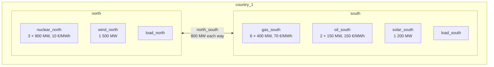

# Two areas, from simulation to Views

This example goes through the whole chain on a study closer to a real one than [Simple setups](simple-setups.md): two areas joined by a link, built with the GEMS [Antares legacy library](https://github.com/AntaresSimulatorTeam/GEMS/blob/main/libraries/antares_legacy_models.yml), simulated with [GemsPy](https://github.com/AntaresSimulatorTeam/GemsPy), and turned into Views by GVB.

Compared with Simple setups, it shows:

| Feature | Where |
|---|---|
| A location that groups several areas (the country), with `extra-locations` | [View configs](#view-configs) |
| The flow on a link, and the net import of each area through it | [Catalogs](#catalogs) |
| Generation split by technology, with `breakdown`, and a single technology, with `filter` | [Catalogs](#catalogs) |
| Metrics located on the link instead of the areas | [Catalogs](#catalogs) |
| Monthly, weekly and yearly patterns, and a `location-filter` | [View configs](#view-configs) |
| One SimulationTable per Monte Carlo scenario, read together | [Simulate the study](#1-simulate-the-study) |
| A simulation solved in two time blocks, and a calendar built from the SimulationTable | [Calendar](#calendar) |
| A check of the Views: energy balance, and country total equal to the sum of the areas | [Check the Views](#check-the-views) |

All the files are in [`docs/examples/two_areas`](https://github.com/AntaresSimulatorTeam/GEMS-ViewsBuilder/tree/main/docs/examples/two_areas) in the repository. Their formats are described in the [GEMS documentation](https://gems-energy.readthedocs.io/en/latest/user-guide/input-files/overview/). The time series are synthetic.

## The study

Two areas of one country, `country_1`, simulated hour by hour for two weeks, from 25 January to 7 February 2030 (336 hours), for 4 Monte Carlo scenarios.



| Component | Model | Role |
|---|---|---|
| `north`, `south` | `area` | the two areas; unsupplied energy costs 5 000 €/MWh |
| `load_north`, `load_south` | `load` | hourly load, different in each scenario |
| `nuclear_north` | `thermal` | cheap base load, in the north |
| `gas_south`, `oil_south` | `thermal` | mid-merit and peak units, in the south |
| `wind_north`, `solar_south` | `renewable` | available power, different in each scenario |
| `north_south` | `link` | 800 MW in each direction, 0.5 €/MWh hurdle cost |

- Power flows mostly from north to south, often up to the link capacity.
- Scenario 3 is a cold spell with little wind: in three hours, on 29 January and 1 February, part of the load is not supplied.

Files of the example (GVB does not expect any folder structure, each input is given by its own option):

```text
two_areas/
├── input/                              # GemsPy study
│   ├── model-libraries/antares_legacy_models.yml
│   ├── system.yml
│   ├── data-series/                    # load, wind and solar, one column per scenario
│   └── optim-config-mc-0.yml … optim-config-mc-3.yml
├── taxonomy.yml                        # GVB inputs
├── catalogs/
│   ├── area_catalog.yml
│   └── link_catalog.yml
├── calendar.csv
├── view-configs/
│   ├── areas_hourly.yml
│   ├── areas_summary.yml
│   └── link_hourly.yml
├── make_calendar.py                    # builds calendar.csv from a SimulationTable
└── check_views.py                      # checks the hourly View
```

## 1. Simulate the study

### Library

The GEMS Antares legacy library, version 2.2.1, unchanged. Its models already declare:

- a `taxonomy-category`: `area` → `balance`, `load` → `fatal_consumption`, `thermal` → `dispatchable_generation`, `renewable` → `renewable_fatal_generation`, `link` → `link`;
- the outputs read by the metrics, for example `price` of the area (dual value of its balance constraint);
- the `properties` each component must give, for example `technology`.

### System

The [system](https://gems-energy.readthedocs.io/en/latest/user-guide/input-files/system/) gives the components and their connections. For GVB:

- **Properties:** thermal and renewable units give their `technology`, used by `breakdown` and `filter`. Each area also gives a `country` property, not declared in the library, used by `extra-locations`.
- **Link ports:** `out_port` injects `flow` into its area, `in_port` injects `-flow`. The north is on `in_port` and the south on `out_port`, so a positive `flow` goes from north to south.
- **Time series:** `input/data-series`, one row per hour, one column per scenario.

=== "Area"

    ```yaml
    --8<-- "docs/examples/two_areas/input/system.yml:area"
    ```

=== "Renewable"

    ```yaml
    --8<-- "docs/examples/two_areas/input/system.yml:renewable"
    ```

=== "Thermal"

    ```yaml
    --8<-- "docs/examples/two_areas/input/system.yml:thermal"
    ```

=== "Link"

    ```yaml
    --8<-- "docs/examples/two_areas/input/system.yml:link"
    ```

=== "Connections of the link"

    ```yaml
    --8<-- "docs/examples/two_areas/input/system.yml:link-connections"
    ```

### Optimisation configuration

One [optimisation configuration](https://gems-energy.readthedocs.io/en/latest/user-guide/input-files/optimization-configuration/) per scenario; the four files differ only by the scenario:

```yaml
--8<-- "docs/examples/two_areas/input/optim-config-mc-0.yml"
```

- `parallel-subproblems` with `block-length: 168` solves the two weeks as two blocks, 0 and 1. The calendar must use the same blocks.
- One scenario per run gives one SimulationTable per scenario. It also keeps the price right: when one GemsPy run solves several scenarios, the dual values, so the `price`, are divided by the number of scenarios.

### Run GemsPy

From the root of the GVB repository, install the environment, then run the four scenarios and keep each SimulationTable under its own name:

```bash
uv sync
cd docs/examples/two_areas
mkdir -p simulation-tables
for s in 0 1 2 3; do
  uv run gemspy --study . --optim-config input/optim-config-mc-$s.yml
  mv output/*/simulation_table_*.csv simulation-tables/st-mc-$s.csv
  rm -r output
done
```

Outputs in the SimulationTables used by this example:

- `north`, `south`: `unsupplied_energy`, `spilled_energy`, `price`
- `load_north`, `load_south`: `actual_load`
- `nuclear_north`, `gas_south`, `oil_south`: `generation_power`, `co2_emissions`
- `wind_north`, `solar_south`: `generation_power`
- `north_south`: `flow`, `minus_flow`, `alg_congestion_fee`, `is_directly_congested`, `is_indirectly_congested`

The SimulationTables are about 1.6 MB each and are not stored in the repository.

## 2. GVB inputs

### Taxonomy

The [taxonomy](https://gems-energy.readthedocs.io/en/latest/user-guide/input-files/taxonomy/) `antares_legacy_taxonomy`, in its flattened form, from the [Antares legacy converter](https://github.com/AntaresSimulatorTeam/AntaresLegacyModels-to-GEMS-Converter). Each category lists all its outputs and ports itself, without `parent-category`.

| Category | Components |
|---|---|
| `balance` | `north`, `south` |
| `fatal_consumption` | `load_north`, `load_south` |
| `dispatchable_generation` | `nuclear_north`, `gas_south`, `oil_south` |
| `renewable_fatal_generation` | `wind_north`, `solar_south` |
| `link` | `north_south` |

??? example "taxonomy.yml"

    ```yaml
    --8<-- "docs/examples/two_areas/taxonomy.yml"
    ```

### Calendar

The calendar must use the same blocks as the SimulationTable: the first week is block 0, the second week block 1.

```text
absolute_time_index,block,granular_date
0,0,2030-01-25 00:00:00
…
167,0,2030-01-31 23:00:00
168,1,2030-02-01 00:00:00
…
335,1,2030-02-07 23:00:00
```

`make_calendar.py` builds it from a SimulationTable:

```python
--8<-- "docs/examples/two_areas/make_calendar.py"
```

```bash
uv run python make_calendar.py
```

### Catalogs

Two [catalogs](https://gems-energy.readthedocs.io/en/latest/user-guide/input-files/catalog/): one for the areas, one for the link.

#### `area_catalog`: metrics located on the areas

```yaml
--8<-- "docs/examples/two_areas/catalogs/area_catalog.yml"
```

| Metric | Reads | Notes |
|---|---|---|
| `LOAD` | `actual_load` of the loads | |
| `GENERATION` | `generation_power` of thermal and renewable units | two terms, one per category |
| `GENERATION_BY_TECHNOLOGY` | same as `GENERATION` | `breakdown` on `technology` |
| `THERMAL_GENERATION` | `generation_power` of thermal units | |
| `GAS_GENERATION` | `generation_power` of thermal units | `filter` on `technology: gas` |
| `NET_IMPORT` | `flow` on `out_port`, `minus_flow` on `in_port` | positive when the area imports |
| `UNSUPPLIED_ENERGY`, `SPILLED_ENERGY` | variables of the areas | `location-port: null` |
| `PRICE` | `price` of the areas | `avg` over areas and over time, not weighted by load |
| `CO2_EMISSIONS` | `co2_emissions` of thermal units | t of CO₂ |

With these metrics, each area balances at every hour:

```text
LOAD = GENERATION + NET_IMPORT + UNSUPPLIED_ENERGY − SPILLED_ENERGY
```

#### `link_catalog`: metrics located on the link

```yaml
--8<-- "docs/examples/two_areas/catalogs/link_catalog.yml"
```

| Metric | Reads | Notes |
|---|---|---|
| `FLOW` | `flow` | positive from north to south |
| `CONGESTION_RENT` | `alg_congestion_fee` | flow × price difference, in € |
| `CONGESTED_HOURS` | `is_directly_congested`, `is_indirectly_congested` | number of hours at full capacity |

### View configs

Three [view configs](https://gems-energy.readthedocs.io/en/latest/user-guide/input-files/view-config/):

=== "areas_hourly.yml"

    ```yaml
    --8<-- "docs/examples/two_areas/view-configs/areas_hourly.yml"
    ```

    - hourly balance of each area, per scenario;
    - `extra-locations` adds `country_1`, from the `country` property of the areas.

=== "areas_summary.yml"

    ```yaml
    --8<-- "docs/examples/two_areas/view-configs/areas_summary.yml"
    ```

    - `monthly`: per month and per scenario;
    - `yearly_stats`: statistics over the scenarios (`exp`, `std`, `min`, `max`);
    - `weekly_country_stats`: weekly statistics, `country_1` only (`location-filter`).

=== "link_hourly.yml"

    ```yaml
    --8<-- "docs/examples/two_areas/view-configs/link_hourly.yml"
    ```

    - link metrics, hourly and as monthly statistics;
    - location category `link`, so only the metrics of `link_catalog`.

## 3. Run GVB

The three view configs, on the four SimulationTables, in one run:

```bash
mkdir -p views
uv run gems-views-builder \
  --libraries-dir     input/model-libraries \
  --system            input/system.yml \
  --taxonomy          taxonomy.yml \
  --catalogs-dir      catalogs \
  --calendar          calendar.csv \
  --view-configs      "view-configs/*.yml" \
  --simulation-tables "simulation-tables/st-mc-*.csv" \
  --output-dir        views
```

- `--simulation-tables` reads the four files together, so every View covers the four scenarios.
- Each view config uses only the catalog of its location category.
- GVB writes six Views, one per aggregation pattern. Add `--output-format csv` for CSV files.

## 4. Read the Views

Energies are in MWh, prices in €/MWh.

### Hourly balance and country total

Read the hourly View with polars, and print `NET_IMPORT` and `PRICE` of scenario 0 at 13:00 on 29 January, when the link is full:

```python
import polars as pl
from datetime import datetime

view = pl.read_parquet("views/areas_hourly*.parquet")
print(view.filter(
    pl.col("metric_id").is_in(["NET_IMPORT", "PRICE"]),
    pl.col("scenario_id") == 0,
    pl.col("view_date") == datetime(2030, 1, 29, 13),
).sort("metric_id", "metric_location"))
```

```text
┌────────────┬────────────┬────────────┬───────────┬───────────┬───────────┬───────────┬───────────┐
│ metric_id  ┆ metric_loc ┆ breakdown_ ┆ view_date ┆ scenario_ ┆ metric_va ┆ scenario_ ┆ scenario_ │
│ ---        ┆ ation      ┆ properties ┆ ---       ┆ id        ┆ lue       ┆ aggregati ┆ stat      │
│ str        ┆ ---        ┆ ---        ┆ datetime[ ┆ ---       ┆ ---       ┆ on        ┆ ---       │
│            ┆ str        ┆ str        ┆ μs]       ┆ i64       ┆ f64       ┆ ---       ┆ str       │
│            ┆            ┆            ┆           ┆           ┆           ┆ bool      ┆           │
╞════════════╪════════════╪════════════╪═══════════╪═══════════╪═══════════╪═══════════╪═══════════╡
│ NET_IMPORT ┆ country_1  ┆ {}         ┆ 2030-01-2 ┆ 0         ┆ 0.0       ┆ false     ┆ null      │
│            ┆            ┆            ┆ 9         ┆           ┆           ┆           ┆           │
│            ┆            ┆            ┆ 13:00:00  ┆           ┆           ┆           ┆           │
│ NET_IMPORT ┆ north      ┆ {}         ┆ 2030-01-2 ┆ 0         ┆ -800.0    ┆ false     ┆ null      │
│            ┆            ┆            ┆ 9         ┆           ┆           ┆           ┆           │
│            ┆            ┆            ┆ 13:00:00  ┆           ┆           ┆           ┆           │
│ NET_IMPORT ┆ south      ┆ {}         ┆ 2030-01-2 ┆ 0         ┆ 800.0     ┆ false     ┆ null      │
│            ┆            ┆            ┆ 9         ┆           ┆           ┆           ┆           │
│            ┆            ┆            ┆ 13:00:00  ┆           ┆           ┆           ┆           │
│ PRICE      ┆ country_1  ┆ {}         ┆ 2030-01-2 ┆ 0         ┆ 40.0      ┆ false     ┆ null      │
│            ┆            ┆            ┆ 9         ┆           ┆           ┆           ┆           │
│            ┆            ┆            ┆ 13:00:00  ┆           ┆           ┆           ┆           │
│ PRICE      ┆ north      ┆ {}         ┆ 2030-01-2 ┆ 0         ┆ 10.0      ┆ false     ┆ null      │
│            ┆            ┆            ┆ 9         ┆           ┆           ┆           ┆           │
│            ┆            ┆            ┆ 13:00:00  ┆           ┆           ┆           ┆           │
│ PRICE      ┆ south      ┆ {}         ┆ 2030-01-2 ┆ 0         ┆ 70.0      ┆ false     ┆ null      │
│            ┆            ┆            ┆ 9         ┆           ┆           ┆           ┆           │
│            ┆            ┆            ┆ 13:00:00  ┆           ┆           ┆           ┆           │
└────────────┴────────────┴────────────┴───────────┴───────────┴───────────┴───────────┴───────────┘
```

- North exports 800 MW, the capacity of the link; south imports it.
- `country_1` is the sum of the areas: its `NET_IMPORT` is 0.
- `PRICE` of `country_1` is the average of the areas: (10 + 70) / 2 = 40.

### Check the Views

`check_views.py` checks, for every hour, scenario and location, the energy balance and that the country total equals the sum of the areas:

```python
--8<-- "docs/examples/two_areas/check_views.py"
```

```bash
uv run python check_views.py
```

```text
largest balance gap: 1.8e-12
┌──────┬────────────┬────────────┬───────────────────┐
│ LOAD ┆ GENERATION ┆ NET_IMPORT ┆ UNSUPPLIED_ENERGY │
│ ---  ┆ ---        ┆ ---        ┆ ---               │
│ f64  ┆ f64        ┆ f64        ┆ f64               │
╞══════╪════════════╪════════════╪═══════════════════╡
│ 0.0  ┆ 1.8190e-12 ┆ 0.0        ┆ 0.0               │
└──────┴────────────┴────────────┴───────────────────┘
```

### The link

Same hour, from the link View:

```python
import polars as pl
from datetime import datetime

view = pl.read_parquet("views/link_hourly*.parquet")
print(view.filter(
    pl.col("scenario_id") == 0,
    pl.col("view_date") == datetime(2030, 1, 29, 13),
).sort("metric_id"))
```

```text
┌────────────┬────────────┬────────────┬───────────┬───────────┬───────────┬───────────┬───────────┐
│ metric_id  ┆ metric_loc ┆ breakdown_ ┆ view_date ┆ scenario_ ┆ metric_va ┆ scenario_ ┆ scenario_ │
│ ---        ┆ ation      ┆ properties ┆ ---       ┆ id        ┆ lue       ┆ aggregati ┆ stat      │
│ str        ┆ ---        ┆ ---        ┆ datetime[ ┆ ---       ┆ ---       ┆ on        ┆ ---       │
│            ┆ str        ┆ str        ┆ μs]       ┆ i64       ┆ f64       ┆ ---       ┆ str       │
│            ┆            ┆            ┆           ┆           ┆           ┆ bool      ┆           │
╞════════════╪════════════╪════════════╪═══════════╪═══════════╪═══════════╪═══════════╪═══════════╡
│ CONGESTED_ ┆ north_sout ┆ {}         ┆ 2030-01-2 ┆ 0         ┆ 1.0       ┆ false     ┆ null      │
│ HOURS      ┆ h          ┆            ┆ 9         ┆           ┆           ┆           ┆           │
│            ┆            ┆            ┆ 13:00:00  ┆           ┆           ┆           ┆           │
│ CONGESTION ┆ north_sout ┆ {}         ┆ 2030-01-2 ┆ 0         ┆ 48000.0   ┆ false     ┆ null      │
│ _RENT      ┆ h          ┆            ┆ 9         ┆           ┆           ┆           ┆           │
│            ┆            ┆            ┆ 13:00:00  ┆           ┆           ┆           ┆           │
│ FLOW       ┆ north_sout ┆ {}         ┆ 2030-01-2 ┆ 0         ┆ 800.0     ┆ false     ┆ null      │
│            ┆ h          ┆            ┆ 9         ┆           ┆           ┆           ┆           │
│            ┆            ┆            ┆ 13:00:00  ┆           ┆           ┆           ┆           │
└────────────┴────────────┴────────────┴───────────┴───────────┴───────────┴───────────┴───────────┘
```

`CONGESTION_RENT` = 800 × (70 − 10) = 48 000 €.

### Generation by technology

February, scenario 3, `country_1`, from the `monthly` pattern:

```python
import polars as pl
from datetime import datetime

view = pl.read_parquet("views/areas_summary*.parquet")
print(view.filter(
    pl.col("metric_id") == "GENERATION_BY_TECHNOLOGY",
    pl.col("metric_location") == "country_1",
    pl.col("scenario_id") == 3,
    pl.col("view_date") == datetime(2030, 2, 1),
).sort("breakdown_properties"))
```

```text
┌────────────┬────────────┬────────────┬───────────┬───────────┬───────────┬───────────┬───────────┐
│ metric_id  ┆ metric_loc ┆ breakdown_ ┆ view_date ┆ scenario_ ┆ metric_va ┆ scenario_ ┆ scenario_ │
│ ---        ┆ ation      ┆ properties ┆ ---       ┆ id        ┆ lue       ┆ aggregati ┆ stat      │
│ str        ┆ ---        ┆ ---        ┆ datetime[ ┆ ---       ┆ ---       ┆ on        ┆ ---       │
│            ┆ str        ┆ str        ┆ μs]       ┆ i64       ┆ f64       ┆ ---       ┆ str       │
│            ┆            ┆            ┆           ┆           ┆           ┆ bool      ┆           │
╞════════════╪════════════╪════════════╪═══════════╪═══════════╪═══════════╪═══════════╪═══════════╡
│ GENERATION ┆ country_1  ┆ {(technolo ┆ 2030-02-0 ┆ 3         ┆ 286195.6  ┆ false     ┆ null      │
│ _BY_TECHNO ┆            ┆ gy,gas)}   ┆ 1         ┆           ┆           ┆           ┆           │
│ LOGY       ┆            ┆            ┆ 00:00:00  ┆           ┆           ┆           ┆           │
│ GENERATION ┆ country_1  ┆ {(technolo ┆ 2030-02-0 ┆ 3         ┆ 450039.5  ┆ false     ┆ null      │
│ _BY_TECHNO ┆            ┆ gy,nuclear ┆ 1         ┆           ┆           ┆           ┆           │
│ LOGY       ┆            ┆ )}         ┆ 00:00:00  ┆           ┆           ┆           ┆           │
│ GENERATION ┆ country_1  ┆ {(technolo ┆ 2030-02-0 ┆ 3         ┆ 2385.0    ┆ false     ┆ null      │
│ _BY_TECHNO ┆            ┆ gy,oil)}   ┆ 1         ┆           ┆           ┆           ┆           │
│ LOGY       ┆            ┆            ┆ 00:00:00  ┆           ┆           ┆           ┆           │
│ GENERATION ┆ country_1  ┆ {(technolo ┆ 2030-02-0 ┆ 3         ┆ 14586.8   ┆ false     ┆ null      │
│ _BY_TECHNO ┆            ┆ gy,solar)} ┆ 1         ┆           ┆           ┆           ┆           │
│ LOGY       ┆            ┆            ┆ 00:00:00  ┆           ┆           ┆           ┆           │
│ GENERATION ┆ country_1  ┆ {(technolo ┆ 2030-02-0 ┆ 3         ┆ 61929.8   ┆ false     ┆ null      │
│ _BY_TECHNO ┆            ┆ gy,wind)}  ┆ 1         ┆           ┆           ┆           ┆           │
│ LOGY       ┆            ┆            ┆ 00:00:00  ┆           ┆           ┆           ┆           │
└────────────┴────────────┴────────────┴───────────┴───────────┴───────────┴───────────┴───────────┘
```

One row per technology of the components of `north` and `south`.

### Statistics over the scenarios

Unsupplied energy of `country_1` over the two weeks, from the `yearly_stats` pattern:

```python
import polars as pl
from datetime import datetime

view = pl.read_parquet("views/areas_summary*.parquet")
print(view.filter(
    pl.col("metric_id") == "UNSUPPLIED_ENERGY",
    pl.col("metric_location") == "country_1",
    pl.col("view_date") == datetime(2030, 1, 1),
    pl.col("scenario_aggregation"),
).sort("scenario_stat"))
```

```text
┌────────────┬────────────┬────────────┬───────────┬───────────┬───────────┬───────────┬───────────┐
│ metric_id  ┆ metric_loc ┆ breakdown_ ┆ view_date ┆ scenario_ ┆ metric_va ┆ scenario_ ┆ scenario_ │
│ ---        ┆ ation      ┆ properties ┆ ---       ┆ id        ┆ lue       ┆ aggregati ┆ stat      │
│ str        ┆ ---        ┆ ---        ┆ datetime[ ┆ ---       ┆ ---       ┆ on        ┆ ---       │
│            ┆ str        ┆ str        ┆ μs]       ┆ i64       ┆ f64       ┆ ---       ┆ str       │
│            ┆            ┆            ┆           ┆           ┆           ┆ bool      ┆           │
╞════════════╪════════════╪════════════╪═══════════╪═══════════╪═══════════╪═══════════╪═══════════╡
│ UNSUPPLIED ┆ country_1  ┆ {}         ┆ 2030-01-0 ┆ null      ┆ 39.05     ┆ true      ┆ exp       │
│ _ENERGY    ┆            ┆            ┆ 1         ┆           ┆           ┆           ┆           │
│            ┆            ┆            ┆ 00:00:00  ┆           ┆           ┆           ┆           │
│ UNSUPPLIED ┆ country_1  ┆ {}         ┆ 2030-01-0 ┆ null      ┆ 156.2     ┆ true      ┆ max       │
│ _ENERGY    ┆            ┆            ┆ 1         ┆           ┆           ┆           ┆           │
│            ┆            ┆            ┆ 00:00:00  ┆           ┆           ┆           ┆           │
│ UNSUPPLIED ┆ country_1  ┆ {}         ┆ 2030-01-0 ┆ null      ┆ 0.0       ┆ true      ┆ min       │
│ _ENERGY    ┆            ┆            ┆ 1         ┆           ┆           ┆           ┆           │
│            ┆            ┆            ┆ 00:00:00  ┆           ┆           ┆           ┆           │
│ UNSUPPLIED ┆ country_1  ┆ {}         ┆ 2030-01-0 ┆ null      ┆ 67.636584 ┆ true      ┆ std       │
│ _ENERGY    ┆            ┆            ┆ 1         ┆           ┆           ┆           ┆           │
│            ┆            ┆            ┆ 00:00:00  ┆           ┆           ┆           ┆           │
└────────────┴────────────┴────────────┴───────────┴───────────┴───────────┴───────────┴───────────┘
```

Only scenario 3 has unsupplied energy: `min` is 0, `max` is 156.2 MWh.

!!! note "Periods are cut by date"
    `view_date` is the start of the period: `2030-01-01` for January and for the year, even though the simulation starts on 25 January. Weeks start on Monday.

## Next steps

- Add an area in another country, with its own `country` property.
- Add a `breakdown` on `name` to see each thermal cluster.
- The rules GVB checks on these files are listed on the [Validation rules](../user-guide/validation-rules.md) page.
