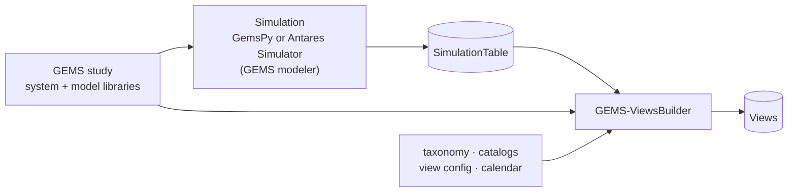

# GEMS-ViewsBuilder

**GEMS-ViewsBuilder (GVB)** turns the results of a GEMS simulation into **Views**: tables of metrics aggregated per location, time granularity and scenario, ready to analyse or plot.

A SimulationTable lists every output of every component at every time step and scenario. A View answers a business question on top of it, for example *"hourly production per area"* or *"yearly unsupplied energy per country, averaged over scenarios"*.

## Where GVB sits in the GEMS chain

GVB runs **after** the simulation and does not simulate anything itself. It reads the SimulationTable written by GemsPy or by the GEMS modeler of Antares Simulator, together with the study it comes from, and aggregates it into the metrics you select.

## Key concepts

| Concept | What it is | Format |
|---|---|---|
| **Taxonomy** | Groups the models of a study into categories (for example *generator*, *load*, *area*) and says which outputs and ports each category exposes. | [Taxonomy file](https://gems-energy.readthedocs.io/en/latest/user-guide/input-files/taxonomy/) |
| **Catalog** | Defines **metrics** from those categories: which outputs to add up, how to aggregate them in time, and how to break them down. | [Catalog file](https://gems-energy.readthedocs.io/en/latest/user-guide/input-files/catalog/) |
| **View config** | Selects metrics from the catalogs, the category that serves as location (for example *area*), and the **aggregation patterns**: time granularity and scenario aggregation. | [Views configuration file](https://gems-energy.readthedocs.io/en/latest/user-guide/input-files/view-config/) |
| **Calendar** | Maps the simulation time indices to dates. | CSV file |
| **View** | The result: one table per view config and aggregation pattern, with one row per metric, location, date and scenario (or scenario statistic). | [Views](https://gems-energy.readthedocs.io/en/latest/user-guide/outputs/views/) |

The study itself, the [system](https://gems-energy.readthedocs.io/en/latest/user-guide/input-files/system/) and its [model libraries](https://gems-energy.readthedocs.io/en/latest/user-guide/input-files/library/), and the [SimulationTable](https://gems-energy.readthedocs.io/en/latest/user-guide/outputs/simulation-table/) are the same files the simulation used and produced.

## What GVB does in a run

1. **Loads and checks** every input: file formats, required columns, and consistency between the taxonomy, the catalogs and the view config.
2. **Locates** each component: finds the location (for example the area) it belongs to, through the connections of the system.
3. **Computes** each selected metric from the SimulationTable.
4. **Aggregates** it per location, in time (hour, day, week, month or year) and, if requested, across scenarios (mean, standard deviation, minimum, maximum).
5. **Writes** the Views as Parquet or CSV files.

## Where to go next

- **[Getting started](getting-started.md)**: install GVB and produce a first View in a few minutes.
- **[User guide](user-guide/command-line.md)**: command line, validation rules, compatibility.
- **[Examples](examples/simple-setups.md)**: from a minimal study to an end-to-end case.

GVB is part of the [GEMS](https://gems-energy.readthedocs.io/en/latest/) ecosystem, alongside [GemsPy](https://github.com/AntaresSimulatorTeam/GemsPy) and [Antares Simulator](https://antares-simulator.org/).
