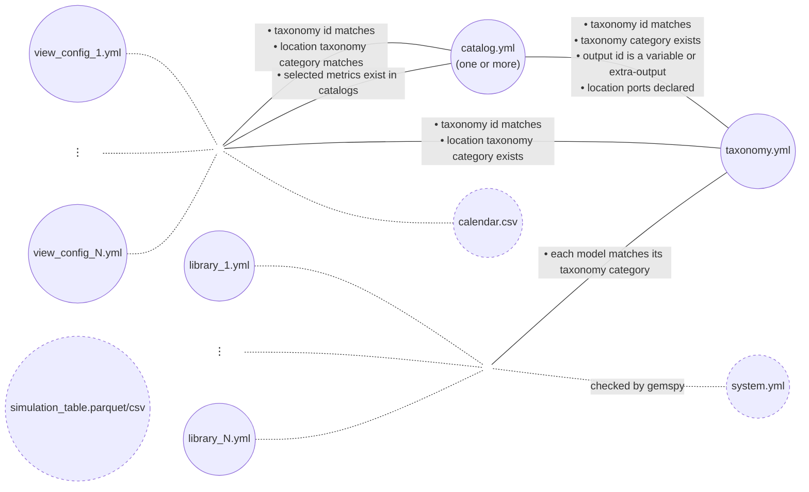

# Input Validation Diagram

Nodes are input files loaded by the pipeline. Edges are the cross-file
checks performed between them, labeled with the checks themselves.

Solid edges = content is cross-validated. Dashed edges = files are read
together or referenced by the study layout, with no cross-file content
check in this repository. [`InputPathsValidator`](../gems_views_builder/validation/input_paths_validator.py)
only checks that those paths have the expected extensions. GemsPy checks
each library against the system when the system is loaded.

## Edge details

### `library_*.yml` → `taxonomy.yml`
[`validate_libraries_against_taxonomy`](../gems_views_builder/validation/library_taxonomy_validator.py)

| Check | Rule |
|---|---|
| Model matches its taxonomy category | every model that declares a `taxonomy-category` exposes the variables, parameters, ports, port-field-definitions, constraints, binding-constraints, extra-outputs and properties required by that category. Delegated to GemsPy `check_library_against_taxonomy`. |

### `catalog.yml` → `taxonomy.yml`
[`CatalogsTaxonomyValidator`](../gems_views_builder/validation/catalogs_taxonomy_validator.py)

| Check | Rule |
|---|---|
| Taxonomy id match | `catalog.taxonomy == taxonomy.id` |
| Taxonomy category exists | every term's `taxonomy-category` is a category defined in `taxonomy.yml` |
| Output id is a variable or extra-output | every term's `output-id` is declared as a `variable` or `extra-output` on that category |
| Location port declared | every term's `location-port` is declared as a `port` on that category |

### `view_config.yml` → `taxonomy.yml`
[`ViewConfigTaxonomyValidator`](../gems_views_builder/validation/view_config_taxonomy.py)

| Check | Rule |
|---|---|
| Taxonomy id match | `view_config.taxonomy_id == taxonomy.id` |
| Location taxonomy category exists | `view_config.location_taxonomy_category` is a category defined in `taxonomy.yml` |

### `catalog.yml` ↔ `view_config.yml`
[`ViewConfigCatalogsValidator`](../gems_views_builder/validation/catalogs_view_config_validator.py)

| Check | Rule |
|---|---|
| Taxonomy id match | `catalog.taxonomy == view_config.taxonomy_id` |
| Location taxonomy category match | `catalog.location_taxonomy_category == view_config.location_taxonomy_category` |

Only catalogs named by that view config's metrics are compared. The same catalog may be named by several view configs.

### `view_config.yml` → `catalog.yml` (selected metrics)
[`ViewConfigMetricsAgainstCatalogsValidator`](../gems_views_builder/validation/view_config_metrics_against_catalogs_validator.py)

| Check | Rule |
|---|---|
| Selected metrics exist | every `<catalog_id>.<metric_id>` names a loaded catalog and a metric in that catalog |

After these checks, [`populate_view_configs_with_metrics`](../gems_views_builder/input/view_config.py) attaches the metric objects to each view config.

## Orchestration

[`InputConsistencyValidator`](../gems_views_builder/validation/input_consistency_validator.py)
runs the checks above, in this order:

1. `validate_libraries_against_taxonomy` (libraries ↔ taxonomy)
2. `CatalogsTaxonomyValidator` (every catalog ↔ taxonomy)
3. `ViewConfigTaxonomyValidator` (each view config ↔ taxonomy)
4. `ViewConfigCatalogsValidator` (each view config ↔ the catalogs it names)
5. `ViewConfigMetricsAgainstCatalogsValidator` (each view config ↔ those catalogs)
