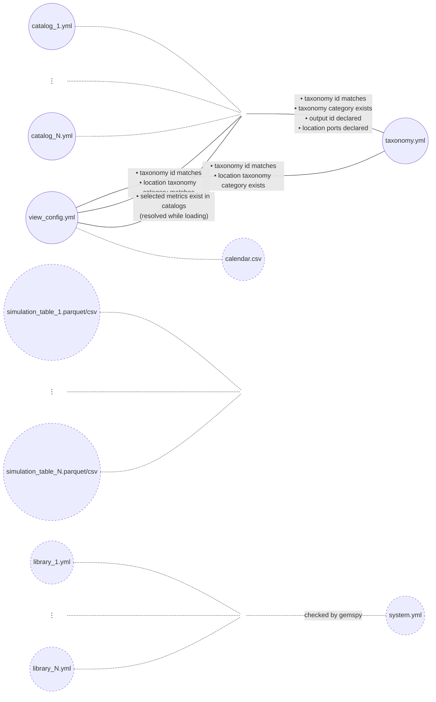

# Input Validation Diagram

Nodes are input files loaded by the pipeline. Edges are the cross-file
checks performed between them, labeled with the checks themselves.

Solid edges = content is cross-validated. Dashed edges = files are read
together / referenced by the study layout, but have no dedicated
cross-file validator yet (see [`StudyLayoutValidator`](../gems_views_builder/validation/study_layout_validator.py),
which only checks that these files are *present*, not their contents).

## Edge details

### `catalog.yml` → `taxonomy.yml`
[`CatalogsTaxonomyValidator`](../gems_views_builder/validation/catalogs_taxonomy_validator.py)

| Check | Rule |
|---|---|
| Taxonomy id match | `catalog.taxonomy == taxonomy.id` |
| Taxonomy category exists | every term's `taxonomy-category` is a category defined in `taxonomy.yml` |
| Output id declared | every term's `output-id` is declared as a `variable` or `extra-output` on that category |
| Location port declared | every term's `location-port` is declared as a `port` on that category |

### `view_config.yml` → `taxonomy.yml`
[`ViewConfigTaxonomyValidator`](../gems_views_builder/validation/view_config_taxonomy.py)

| Check | Rule |
|---|---|
| Taxonomy id match | `view_config.taxonomy_id == taxonomy.id` |
| Location taxonomy category exists | `view_config.location_taxonomy_category` is a category defined in `taxonomy.yml` |

### `catalog.yml` ↔ `view_config.yml`
[`ViewConfigCatalogsValidator`](../gems_views_builder/validation/catalogs_view_config_validator.py)

| Check | Rule |
|---|---|
| Taxonomy id match | `catalog.taxonomy == view_config.taxonomy_id` |
| Location taxonomy category match | `catalog.location_taxonomy_category == view_config.location_taxonomy_category` |

Selected metrics are resolved while loading, in [`ViewConfig.populate_with_metrics`](../gems_views_builder/input/view_config.py). Every `<catalog_id>.<metric_id>` must name a loaded catalog and a metric in that catalog.

## Orchestration

[`InputConsistencyValidator`](../gems_views_builder/validation/input_consistency_validator.py)
runs the validators above, in this order:

1. `CatalogsTaxonomyValidator` (catalog ↔ taxonomy)
2. `ViewConfigTaxonomyValidator` (view_config ↔ taxonomy)
3. `ViewConfigCatalogsValidator` (catalog ↔ view_config)