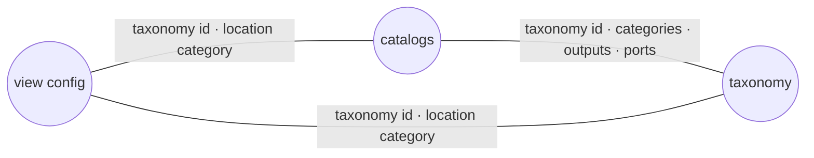

# Validation rules

GVB checks the command line and all input files before building any View. Components are located while each view config is built (section 7). GVB stops at the **first** rule that fails and reports which file and which rule:

- problems with the command line itself (a missing or unknown option, a path that does not exist) end the run with **exit code 2**;
- every other problem ends the run with **exit code 1**.

The message is printed in the terminal and written to the log file. Only a missing, unknown or abbreviated option is reported in the terminal alone, because it is detected before the log file is opened.

The checks run in the order of the sections below.

## 1. Command line paths

| Rule | Example message |
|---|---|
| Every required option is given, with its full name (abbreviations are not accepted). | `the following arguments are required: --catalogs-dir` |
| `--system`, `--taxonomy` and `--calendar` point to existing files. | `--calendar is not a file: …` |
| `--libraries-dir` and `--catalogs-dir` point to existing folders. | `--catalogs-dir is not a directory: …` |
| `--simulation-tables` and `--view-configs` are not empty and end with a file name or a file name pattern, not with `.`. | `--simulation-tables : '.' does not end with a file name pattern` |
| The folder part of those patterns is an existing folder. It may be the current folder, as in `"st-*.parquet"`. | `--simulation-tables : folder 'missing' of glob pattern 'missing/st-x-mc-*.parquet' is not an existing folder` |
| `--output-dir` is an existing folder. The `--log-dir` folder is created if it does not exist. | `--output-dir is not a directory: …` |

## 2. Files and extensions

| Input | Rule |
|---|---|
| System, taxonomy | `.yml` file |
| Libraries folder | contains only `.yml` files, and at least one |
| Catalogs folder | contains only `.yml` files, and at least one; any other file or sub-folder is an error |
| View configs | every matched file is `.yml` |
| Calendar | `.csv` file |
| View configs, SimulationTables | at least one file matches the pattern, for example `No files matched global pattern: output/st-*.parquet`. A pattern that ends with a folder name, such as `output/`, matches no file. |
| SimulationTables | every file is `.parquet` or `.csv`; all files use the **same** extension |

## 3. Content of each file

Each YAML file is read against its GEMS format. **Unknown fields are rejected**, so a misspelt key is reported instead of being silently ignored.

| File | Rules | Format |
|---|---|---|
| Taxonomy | root key `taxonomy:` | [Taxonomy file](https://gems-energy.readthedocs.io/en/latest/user-guide/input-files/taxonomy/) |
| Catalog | root key `catalog:`; each catalog `id` is used only once across the folder (`Catalog id 'x' defined more than once in catalogs (also found in a different file)`); every term has a `location-port` key (`null` when the term has no location port), and it is not blank; `terms-operator` and `time-operator` are `sum` or `avg`; a metric `filter` has both a `key` and a `value` | [Catalog file](https://gems-energy.readthedocs.io/en/latest/user-guide/input-files/catalog/) |
| View config | root key `view:`; the `id` contains only letters, digits, `_` and `-` (it is used in the View file names); at least one aggregation pattern and one metric; time granularity is one of `hour`, `day`, `week`, `month`, `year` | [Views configuration file](https://gems-energy.readthedocs.io/en/latest/user-guide/input-files/view-config/) |
| Model libraries | read by GemsPy; each library id is defined only once across the folder | [Library file](https://gems-energy.readthedocs.io/en/latest/user-guide/input-files/library/) |
| System | read by GemsPy against the libraries; each component sets every property its model declares, each property only once | [System file](https://gems-energy.readthedocs.io/en/latest/user-guide/input-files/system/) |
| SimulationTables | exactly these columns, no missing and no extra ones: `block`, `component`, `output`, `absolute_time_index`, `block_time_index`, `scenario_index`, `value`, `basis_status` | [Simulation Table](https://gems-energy.readthedocs.io/en/latest/user-guide/outputs/simulation-table/) |
| Calendar | exactly the columns `absolute_time_index`, `block`, `granular_date`; `absolute_time_index` runs 0, 1, 2, … without gaps; the step between consecutive `granular_date` values is constant | — |

## 4. View configs and aggregation patterns

Across all view configs given with `--view-configs`:

- each view config `id` is used **only once**;
- every selected metric is written `<catalog id>.<metric id>`, with exactly one dot.

For each view config:

- each aggregation pattern `id` is used **only once**, for example `Aggregation pattern 'hourly' is defined multiple times`;
- at most **10** aggregation patterns (5 time granularities × with or without scenario aggregation);
- each combination of time granularity and scenario aggregation appears **only once**.

## 5. Consistency between files

All catalogs are first checked against the taxonomy (row 1). Rows 2 and 3 then run for **every view config** given with `--view-configs`.

| # | Between | Rule |
|---|---|---|
| 1 | catalogs and taxonomy | `catalog.taxonomy` is the taxonomy id; every term's `taxonomy-category` exists in the taxonomy; every `output-id` is declared as a variable or extra-output of that category; every `location-port` is declared as a port of that category |
| 2 | view config and taxonomy | `view.taxonomy` is the taxonomy id; the location `taxonomy-category` is a category of the taxonomy |
| 3 | catalogs and view config | every catalog **used by the view config** (named in its metrics) uses the same taxonomy and the same location taxonomy category as the view config |

## 6. Selected metrics

After the consistency checks, each metric selected by a view config is looked up in its catalog:

| Rule | Example message |
|---|---|
| the catalog exists | `Catalog 'catalog' used in view config 'view_area' doesn't exist!` |
| the metric exists in that catalog | `Metric 'PROD' used in view config 'view_area' doesn't exist in catalog 'catalog'` |

## 7. Locating components

Before building the Views, every component of the system must use a model that declares a `taxonomy-category`.

Then, while building the Views of each view config, GVB finds the location of each component used by a selected metric:

- a term **with** a `location-port`: the component must be connected, on that port, to **exactly one** component, and that component must belong to the location taxonomy category of the view config;
- a term **without** a `location-port`: the term's taxonomy category must be the location taxonomy category itself (the component is its own location).

If a component cannot be located, the run stops with a message naming the component, for example:

| Case | Example message |
|---|---|
| no peer, or several peers, on the location port | `Component 'gen_1' port balance_port has 0 peers, expected 1` |
| the peer is not in the location taxonomy category | `Component 'gen_1' port balance_port has peer 'node_1' with taxonomy category 'node', expected 'balance'` |
| no location port, and the component is not in the location taxonomy category | `Component 'gen_1' has taxonomy category 'generator', expected 'balance'` |

## What is not checked

Some inputs are matched rather than checked. When they do not match, GVB gives fewer rows or an empty value, not an error:

| Input | Behaviour |
|---|---|
| SimulationTable rows and calendar | A time-dependent row is kept only if its `absolute_time_index` is in the calendar **and** its `block` is the `block` of that calendar row. Other rows are left out. Rows that do not depend on time (no `absolute_time_index`) are always kept. |
| `location-filter` of an aggregation pattern | A location id that does not exist matches no row. |
| `extra-locations` of the view config scope | A location component that does not have the named property gets no extra location. |
| `scope.calendar` of the view config | Not compared with anything: the calendar given with `--calendar` is always used. |
| Components without SimulationTable rows | A component of the system with no rows in the SimulationTables gives empty values in the View. |
