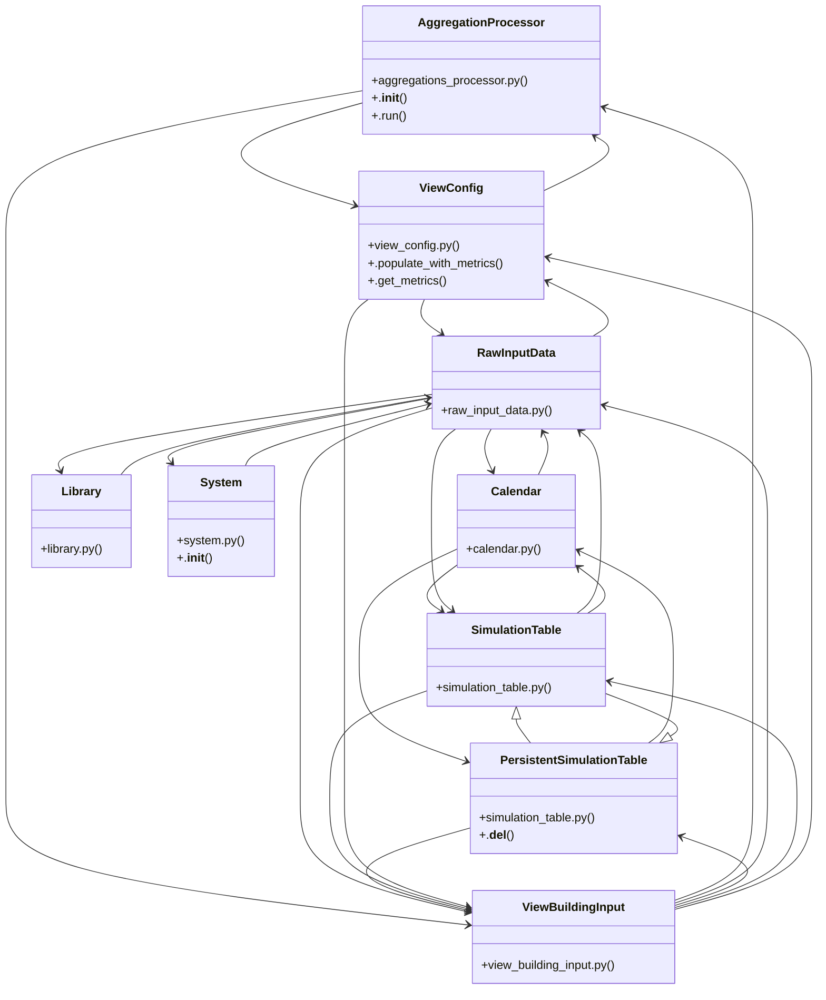

# Community 1

> 87 nodes · cohesion 0.05

## Key Concepts

- [ViewConfig](file:///home/rtei-beg-see-dp/GEMS-DEVELOPMENT/GEMS-ViewsBuilder/gems_views_builder/input/view_config.py#L59) (42 connections)
- [SimulationTable](file:///home/rtei-beg-see-dp/GEMS-DEVELOPMENT/GEMS-ViewsBuilder/gems_views_builder/input/simulation_table.py#L51) (23 connections)
- [RawInputData](file:///home/rtei-beg-see-dp/GEMS-DEVELOPMENT/GEMS-ViewsBuilder/gems_views_builder/input/raw_input_data.py#L17) (22 connections)
- [join()](file:///home/rtei-beg-see-dp/GEMS-DEVELOPMENT/GEMS-ViewsBuilder/gems_views_builder/input/simulation_table.py#L137) (18 connections)
- [Calendar](file:///home/rtei-beg-see-dp/GEMS-DEVELOPMENT/GEMS-ViewsBuilder/gems_views_builder/input/calendar.py#L14) (16 connections)
- [filter_simulation_table()](file:///home/rtei-beg-see-dp/GEMS-DEVELOPMENT/GEMS-ViewsBuilder/gems_views_builder/input/simulation_table.py#L91) (14 connections)
- [AggregationProcessor](file:///home/rtei-beg-see-dp/GEMS-DEVELOPMENT/GEMS-ViewsBuilder/gems_views_builder/aggregators/aggregations_processor.py#L15) (11 connections)
- [ViewBuildingInput](file:///home/rtei-beg-see-dp/GEMS-DEVELOPMENT/GEMS-ViewsBuilder/gems_views_builder/input/view_building_input.py#L21) (11 connections)
- [test_filter_simulation_table.py](file:///home/rtei-beg-see-dp/GEMS-DEVELOPMENT/GEMS-ViewsBuilder/tests/unit/test_filter_simulation_table.py#L1) (10 connections)
- [PersistentSimulationTable](file:///home/rtei-beg-see-dp/GEMS-DEVELOPMENT/GEMS-ViewsBuilder/gems_views_builder/input/simulation_table.py#L58) (10 connections)
- [Constructor should not read yaml or parquet.     Multi-file inputs are resolved](file:///home/rtei-beg-see-dp/GEMS-DEVELOPMENT/GEMS-ViewsBuilder/tests/test_loader.py#L22) (10 connections)
- [test_filter_simulation_table_writes_parquet()](file:///home/rtei-beg-see-dp/GEMS-DEVELOPMENT/GEMS-ViewsBuilder/tests/unit/test_filter_simulation_table.py#L106) (9 connections)
- [load_calendar()](file:///home/rtei-beg-see-dp/GEMS-DEVELOPMENT/GEMS-ViewsBuilder/gems_views_builder/input/calendar.py#L27) (8 connections)
- [Library](file:///home/rtei-beg-see-dp/GEMS-DEVELOPMENT/GEMS-ViewsBuilder/gems_views_builder/input/library.py#L13) (8 connections)
- [load_simulation_table()](file:///home/rtei-beg-see-dp/GEMS-DEVELOPMENT/GEMS-ViewsBuilder/gems_views_builder/input/simulation_table.py#L77) (8 connections)
- [test_filter_simulation_table_logical()](file:///home/rtei-beg-see-dp/GEMS-DEVELOPMENT/GEMS-ViewsBuilder/tests/unit/test_filter_simulation_table.py#L40) (8 connections)
- [Inputs of the view-building algorithm for one view config.](file:///home/rtei-beg-see-dp/GEMS-DEVELOPMENT/GEMS-ViewsBuilder/gems_views_builder/input/view_building_input.py#L22) (8 connections)
- [calendar.py](file:///home/rtei-beg-see-dp/GEMS-DEVELOPMENT/GEMS-ViewsBuilder/gems_views_builder/input/calendar.py#L1) (7 connections)
- [make_pair_id()](file:///home/rtei-beg-see-dp/GEMS-DEVELOPMENT/GEMS-ViewsBuilder/gems_views_builder/pair_id.py#L34) (7 connections)
- [Study inputs as loaded from disk, before view-building transformations.](file:///home/rtei-beg-see-dp/GEMS-DEVELOPMENT/GEMS-ViewsBuilder/gems_views_builder/input/raw_input_data.py#L18) (7 connections)
- [System](file:///home/rtei-beg-see-dp/GEMS-DEVELOPMENT/GEMS-ViewsBuilder/gems_views_builder/input/system.py#L18) (7 connections)
- [test_filter_simulation_table_keeps_calendar_matching_rows_from_every_table()](file:///home/rtei-beg-see-dp/GEMS-DEVELOPMENT/GEMS-ViewsBuilder/tests/unit/test_filter_simulation_table.py#L161) (7 connections)
- [build_raw_input_data()](file:///home/rtei-beg-see-dp/GEMS-DEVELOPMENT/GEMS-ViewsBuilder/tests/e2e/utils.py#L75) (7 connections)
- [Build a real RawInputData, skipping only the disk-reading Loader.load() step:](file:///home/rtei-beg-see-dp/GEMS-DEVELOPMENT/GEMS-ViewsBuilder/tests/e2e/utils.py#L83) (7 connections)
- [_check_calendar_columns()](file:///home/rtei-beg-see-dp/GEMS-DEVELOPMENT/GEMS-ViewsBuilder/gems_views_builder/input/calendar.py#L37) (6 connections)
- *... and 62 more nodes in this community*

## Class Diagram

## Relationships

- No strong cross-community connections detected

## Source Files

- [/home/rtei-beg-see-dp/GEMS-DEVELOPMENT/GEMS-ViewsBuilder/gems_views_builder/aggregators/aggregations_processor.py](file:///home/rtei-beg-see-dp/GEMS-DEVELOPMENT/GEMS-ViewsBuilder/gems_views_builder/aggregators/aggregations_processor.py)
- [/home/rtei-beg-see-dp/GEMS-DEVELOPMENT/GEMS-ViewsBuilder/gems_views_builder/input/calendar.py](file:///home/rtei-beg-see-dp/GEMS-DEVELOPMENT/GEMS-ViewsBuilder/gems_views_builder/input/calendar.py)
- [/home/rtei-beg-see-dp/GEMS-DEVELOPMENT/GEMS-ViewsBuilder/gems_views_builder/input/library.py](file:///home/rtei-beg-see-dp/GEMS-DEVELOPMENT/GEMS-ViewsBuilder/gems_views_builder/input/library.py)
- [/home/rtei-beg-see-dp/GEMS-DEVELOPMENT/GEMS-ViewsBuilder/gems_views_builder/input/raw_input_data.py](file:///home/rtei-beg-see-dp/GEMS-DEVELOPMENT/GEMS-ViewsBuilder/gems_views_builder/input/raw_input_data.py)
- [/home/rtei-beg-see-dp/GEMS-DEVELOPMENT/GEMS-ViewsBuilder/gems_views_builder/input/simulation_table.py](file:///home/rtei-beg-see-dp/GEMS-DEVELOPMENT/GEMS-ViewsBuilder/gems_views_builder/input/simulation_table.py)
- [/home/rtei-beg-see-dp/GEMS-DEVELOPMENT/GEMS-ViewsBuilder/gems_views_builder/input/system.py](file:///home/rtei-beg-see-dp/GEMS-DEVELOPMENT/GEMS-ViewsBuilder/gems_views_builder/input/system.py)
- [/home/rtei-beg-see-dp/GEMS-DEVELOPMENT/GEMS-ViewsBuilder/gems_views_builder/input/view_building_input.py](file:///home/rtei-beg-see-dp/GEMS-DEVELOPMENT/GEMS-ViewsBuilder/gems_views_builder/input/view_building_input.py)
- [/home/rtei-beg-see-dp/GEMS-DEVELOPMENT/GEMS-ViewsBuilder/gems_views_builder/input/view_config.py](file:///home/rtei-beg-see-dp/GEMS-DEVELOPMENT/GEMS-ViewsBuilder/gems_views_builder/input/view_config.py)
- [/home/rtei-beg-see-dp/GEMS-DEVELOPMENT/GEMS-ViewsBuilder/gems_views_builder/pair_id.py](file:///home/rtei-beg-see-dp/GEMS-DEVELOPMENT/GEMS-ViewsBuilder/gems_views_builder/pair_id.py)
- [/home/rtei-beg-see-dp/GEMS-DEVELOPMENT/GEMS-ViewsBuilder/gems_views_builder/validation/simulation_tables.py](file:///home/rtei-beg-see-dp/GEMS-DEVELOPMENT/GEMS-ViewsBuilder/gems_views_builder/validation/simulation_tables.py)
- [/home/rtei-beg-see-dp/GEMS-DEVELOPMENT/GEMS-ViewsBuilder/tests/common.py](file:///home/rtei-beg-see-dp/GEMS-DEVELOPMENT/GEMS-ViewsBuilder/tests/common.py)
- [/home/rtei-beg-see-dp/GEMS-DEVELOPMENT/GEMS-ViewsBuilder/tests/e2e/utils.py](file:///home/rtei-beg-see-dp/GEMS-DEVELOPMENT/GEMS-ViewsBuilder/tests/e2e/utils.py)
- [/home/rtei-beg-see-dp/GEMS-DEVELOPMENT/GEMS-ViewsBuilder/tests/test_loader.py](file:///home/rtei-beg-see-dp/GEMS-DEVELOPMENT/GEMS-ViewsBuilder/tests/test_loader.py)
- [/home/rtei-beg-see-dp/GEMS-DEVELOPMENT/GEMS-ViewsBuilder/tests/unit/test_concat_simulation_tables.py](file:///home/rtei-beg-see-dp/GEMS-DEVELOPMENT/GEMS-ViewsBuilder/tests/unit/test_concat_simulation_tables.py)
- [/home/rtei-beg-see-dp/GEMS-DEVELOPMENT/GEMS-ViewsBuilder/tests/unit/test_filter_simulation_table.py](file:///home/rtei-beg-see-dp/GEMS-DEVELOPMENT/GEMS-ViewsBuilder/tests/unit/test_filter_simulation_table.py)
- [/home/rtei-beg-see-dp/GEMS-DEVELOPMENT/GEMS-ViewsBuilder/tests/unit/test_load_simulation_tables.py](file:///home/rtei-beg-see-dp/GEMS-DEVELOPMENT/GEMS-ViewsBuilder/tests/unit/test_load_simulation_tables.py)
- [/home/rtei-beg-see-dp/GEMS-DEVELOPMENT/GEMS-ViewsBuilder/tests/unit/test_validate_simulation_tables.py](file:///home/rtei-beg-see-dp/GEMS-DEVELOPMENT/GEMS-ViewsBuilder/tests/unit/test_validate_simulation_tables.py)

## Audit Trail

- EXTRACTED: 206 (43%)
- INFERRED: 272 (57%)
- AMBIGUOUS: 0 (0%)

---

*Part of the graphify knowledge wiki. See [[index]] to navigate.*