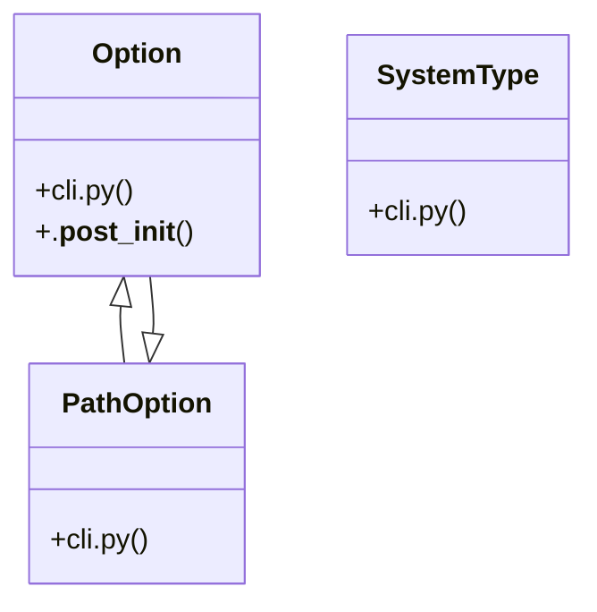

# Community 11

> 12 nodes · cohesion 0.24

## Key Concepts

- [cli.py](file:///home/rtei-beg-see-dp/GEMS-DEVELOPMENT/GEMS-ViewsBuilder/gems_views_builder/cli.py#L1) (11 connections)
- [build_parser()](file:///home/rtei-beg-see-dp/GEMS-DEVELOPMENT/GEMS-ViewsBuilder/gems_views_builder/cli.py#L51) (4 connections)
- [check_options()](file:///home/rtei-beg-see-dp/GEMS-DEVELOPMENT/GEMS-ViewsBuilder/gems_views_builder/cli.py#L127) (4 connections)
- [Option](file:///home/rtei-beg-see-dp/GEMS-DEVELOPMENT/GEMS-ViewsBuilder/gems_views_builder/cli.py#L19) (3 connections)
- [add_multiple_file_path_options()](file:///home/rtei-beg-see-dp/GEMS-DEVELOPMENT/GEMS-ViewsBuilder/gems_views_builder/cli.py#L99) (2 connections)
- [add_path_options()](file:///home/rtei-beg-see-dp/GEMS-DEVELOPMENT/GEMS-ViewsBuilder/gems_views_builder/cli.py#L89) (2 connections)
- [check_multiple_file_path_options()](file:///home/rtei-beg-see-dp/GEMS-DEVELOPMENT/GEMS-ViewsBuilder/gems_views_builder/cli.py#L116) (2 connections)
- [check_paths_options()](file:///home/rtei-beg-see-dp/GEMS-DEVELOPMENT/GEMS-ViewsBuilder/gems_views_builder/cli.py#L109) (2 connections)
- [PathOption](file:///home/rtei-beg-see-dp/GEMS-DEVELOPMENT/GEMS-ViewsBuilder/gems_views_builder/cli.py#L29) (2 connections)
- [SystemType](file:///home/rtei-beg-see-dp/GEMS-DEVELOPMENT/GEMS-ViewsBuilder/gems_views_builder/cli.py#L13) (2 connections)
- [.__post_init__()](file:///home/rtei-beg-see-dp/GEMS-DEVELOPMENT/GEMS-ViewsBuilder/gems_views_builder/cli.py#L24) (1 connections)
- [parent_is_dir()](file:///home/rtei-beg-see-dp/GEMS-DEVELOPMENT/GEMS-ViewsBuilder/gems_views_builder/cli.py#L33) (1 connections)

## Class Diagram

## Relationships

- No strong cross-community connections detected

## Source Files

- [/home/rtei-beg-see-dp/GEMS-DEVELOPMENT/GEMS-ViewsBuilder/gems_views_builder/cli.py](file:///home/rtei-beg-see-dp/GEMS-DEVELOPMENT/GEMS-ViewsBuilder/gems_views_builder/cli.py)

## Audit Trail

- EXTRACTED: 34 (94%)
- INFERRED: 2 (6%)
- AMBIGUOUS: 0 (0%)

---

*Part of the graphify knowledge wiki. See [[index]] to navigate.*