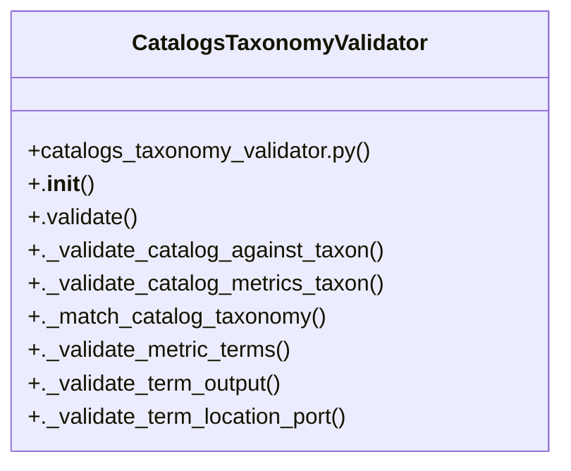

# Community 13

> 11 nodes · cohesion 0.31

## Key Concepts

- [CatalogsTaxonomyValidator](file:///home/rtei-beg-see-dp/GEMS-DEVELOPMENT/GEMS-ViewsBuilder/gems_views_builder/validation/catalogs_taxonomy_validator.py#L10) (16 connections)
- [._validate_catalog_against_taxon()](file:///home/rtei-beg-see-dp/GEMS-DEVELOPMENT/GEMS-ViewsBuilder/gems_views_builder/validation/catalogs_taxonomy_validator.py#L22) (4 connections)
- [._validate_metric_terms()](file:///home/rtei-beg-see-dp/GEMS-DEVELOPMENT/GEMS-ViewsBuilder/gems_views_builder/validation/catalogs_taxonomy_validator.py#L40) (4 connections)
- [._validate_catalog_metrics_taxon()](file:///home/rtei-beg-see-dp/GEMS-DEVELOPMENT/GEMS-ViewsBuilder/gems_views_builder/validation/catalogs_taxonomy_validator.py#L27) (3 connections)
- [._validate_term_output()](file:///home/rtei-beg-see-dp/GEMS-DEVELOPMENT/GEMS-ViewsBuilder/gems_views_builder/validation/catalogs_taxonomy_validator.py#L51) (3 connections)
- [allowed_output()](file:///home/rtei-beg-see-dp/GEMS-DEVELOPMENT/GEMS-ViewsBuilder/gems_views_builder/validation/catalogs_taxonomy_validator.py#L68) (2 connections)
- [._match_catalog_taxonomy()](file:///home/rtei-beg-see-dp/GEMS-DEVELOPMENT/GEMS-ViewsBuilder/gems_views_builder/validation/catalogs_taxonomy_validator.py#L34) (2 connections)
- [.validate()](file:///home/rtei-beg-see-dp/GEMS-DEVELOPMENT/GEMS-ViewsBuilder/gems_views_builder/validation/catalogs_taxonomy_validator.py#L16) (2 connections)
- [._validate_term_location_port()](file:///home/rtei-beg-see-dp/GEMS-DEVELOPMENT/GEMS-ViewsBuilder/gems_views_builder/validation/catalogs_taxonomy_validator.py#L59) (2 connections)
- [catalogs_taxonomy_validator.py](file:///home/rtei-beg-see-dp/GEMS-DEVELOPMENT/GEMS-ViewsBuilder/gems_views_builder/validation/catalogs_taxonomy_validator.py#L1) (2 connections)
- [.__init__()](file:///home/rtei-beg-see-dp/GEMS-DEVELOPMENT/GEMS-ViewsBuilder/gems_views_builder/validation/catalogs_taxonomy_validator.py#L11) (1 connections)

## Class Diagram

## Relationships

- No strong cross-community connections detected

## Source Files

- [/home/rtei-beg-see-dp/GEMS-DEVELOPMENT/GEMS-ViewsBuilder/gems_views_builder/validation/catalogs_taxonomy_validator.py](file:///home/rtei-beg-see-dp/GEMS-DEVELOPMENT/GEMS-ViewsBuilder/gems_views_builder/validation/catalogs_taxonomy_validator.py)

## Audit Trail

- EXTRACTED: 34 (83%)
- INFERRED: 7 (17%)
- AMBIGUOUS: 0 (0%)

---

*Part of the graphify knowledge wiki. See [[index]] to navigate.*