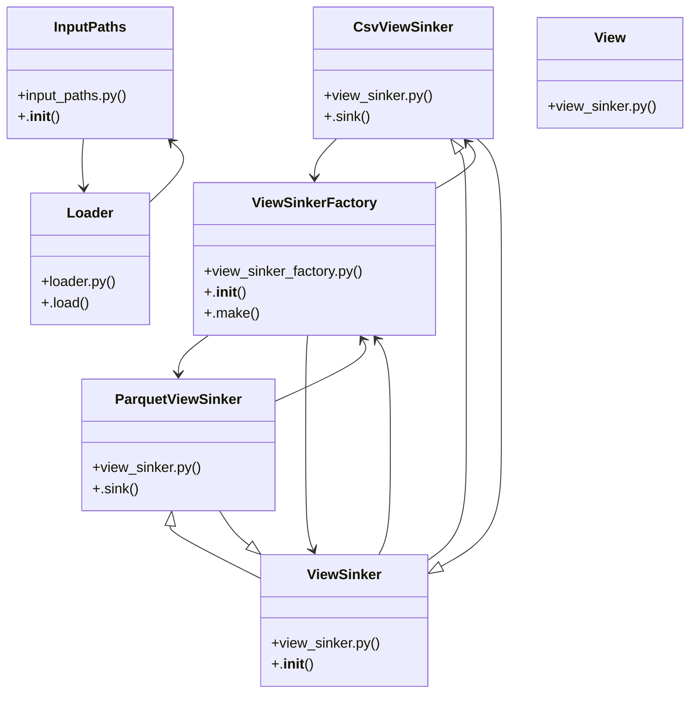

# Community 2

> 67 nodes · cohesion 0.05

## Key Concepts

- [run_view_building_process()](file:///home/rtei-beg-see-dp/GEMS-DEVELOPMENT/GEMS-ViewsBuilder/gems_views_builder/__main__.py#L46) (17 connections)
- [paths_from_dataset()](file:///home/rtei-beg-see-dp/GEMS-DEVELOPMENT/GEMS-ViewsBuilder/tests/conftest.py#L31) (13 connections)
- [InputPaths](file:///home/rtei-beg-see-dp/GEMS-DEVELOPMENT/GEMS-ViewsBuilder/gems_views_builder/input_paths.py#L12) (13 connections)
- [.load()](file:///home/rtei-beg-see-dp/GEMS-DEVELOPMENT/GEMS-ViewsBuilder/gems_views_builder/loader.py#L23) (13 connections)
- [ParquetViewSinker](file:///home/rtei-beg-see-dp/GEMS-DEVELOPMENT/GEMS-ViewsBuilder/gems_views_builder/view/view_sinker.py#L29) (12 connections)
- [main()](file:///home/rtei-beg-see-dp/GEMS-DEVELOPMENT/GEMS-ViewsBuilder/gems_views_builder/__main__.py#L86) (11 connections)
- [Loader](file:///home/rtei-beg-see-dp/GEMS-DEVELOPMENT/GEMS-ViewsBuilder/gems_views_builder/loader.py#L20) (9 connections)
- [ViewSinkerFactory](file:///home/rtei-beg-see-dp/GEMS-DEVELOPMENT/GEMS-ViewsBuilder/gems_views_builder/view/view_sinker_factory.py#L8) (9 connections)
- [test_yaml_time_aggregation_drives_full_pipeline()](file:///home/rtei-beg-see-dp/GEMS-DEVELOPMENT/GEMS-ViewsBuilder/tests/e2e/test_time_aggregation_e2e.py#L48) (8 connections)
- [timed_step()](file:///home/rtei-beg-see-dp/GEMS-DEVELOPMENT/GEMS-ViewsBuilder/gems_views_builder/common.py#L43) (7 connections)
- [conftest.py](file:///home/rtei-beg-see-dp/GEMS-DEVELOPMENT/GEMS-ViewsBuilder/tests/conftest.py#L1) (7 connections)
- [ViewSinker](file:///home/rtei-beg-see-dp/GEMS-DEVELOPMENT/GEMS-ViewsBuilder/gems_views_builder/view/view_sinker.py#L19) (7 connections)
- [is_valid_dataset_dir()](file:///home/rtei-beg-see-dp/GEMS-DEVELOPMENT/GEMS-ViewsBuilder/tests/conftest.py#L50) (6 connections)
- [view_sinker.py](file:///home/rtei-beg-see-dp/GEMS-DEVELOPMENT/GEMS-ViewsBuilder/gems_views_builder/view/view_sinker.py#L1) (6 connections)
- [load_and_validate_input_data()](file:///home/rtei-beg-see-dp/GEMS-DEVELOPMENT/GEMS-ViewsBuilder/gems_views_builder/__main__.py#L34) (6 connections)
- [.make()](file:///home/rtei-beg-see-dp/GEMS-DEVELOPMENT/GEMS-ViewsBuilder/gems_views_builder/view/view_sinker_factory.py#L13) (6 connections)
- [accumulate_on_disk()](file:///home/rtei-beg-see-dp/GEMS-DEVELOPMENT/GEMS-ViewsBuilder/gems_views_builder/view/accumulate_views.py#L26) (5 connections)
- [common.py](file:///home/rtei-beg-see-dp/GEMS-DEVELOPMENT/GEMS-ViewsBuilder/gems_views_builder/common.py#L1) (5 connections)
- [test_time_aggregation_e2e.py](file:///home/rtei-beg-see-dp/GEMS-DEVELOPMENT/GEMS-ViewsBuilder/tests/e2e/test_time_aggregation_e2e.py#L1) (5 connections)
- [filtering_and_breakdown_workspace()](file:///home/rtei-beg-see-dp/GEMS-DEVELOPMENT/GEMS-ViewsBuilder/tests/unit/test_filtering_and_breakdown.py#L30) (5 connections)
- [test_log_messages_emitted_to_stdout()](file:///home/rtei-beg-see-dp/GEMS-DEVELOPMENT/GEMS-ViewsBuilder/tests/unit/test_view_builder.py#L97) (5 connections)
- [CsvViewSinker](file:///home/rtei-beg-see-dp/GEMS-DEVELOPMENT/GEMS-ViewsBuilder/gems_views_builder/view/view_sinker.py#L37) (5 connections)
- **ABC** (4 connections)
- [configure_logging()](file:///home/rtei-beg-see-dp/GEMS-DEVELOPMENT/GEMS-ViewsBuilder/gems_views_builder/common.py#L60) (4 connections)
- [peak_rss_gib()](file:///home/rtei-beg-see-dp/GEMS-DEVELOPMENT/GEMS-ViewsBuilder/gems_views_builder/common.py#L31) (4 connections)
- *... and 42 more nodes in this community*

## Class Diagram

## Relationships

- No strong cross-community connections detected

## Source Files

- [/home/rtei-beg-see-dp/GEMS-DEVELOPMENT/GEMS-ViewsBuilder/gems_views_builder/__main__.py](file:///home/rtei-beg-see-dp/GEMS-DEVELOPMENT/GEMS-ViewsBuilder/gems_views_builder/__main__.py)
- [/home/rtei-beg-see-dp/GEMS-DEVELOPMENT/GEMS-ViewsBuilder/gems_views_builder/aggregators/aggregations_processor.py](file:///home/rtei-beg-see-dp/GEMS-DEVELOPMENT/GEMS-ViewsBuilder/gems_views_builder/aggregators/aggregations_processor.py)
- [/home/rtei-beg-see-dp/GEMS-DEVELOPMENT/GEMS-ViewsBuilder/gems_views_builder/common.py](file:///home/rtei-beg-see-dp/GEMS-DEVELOPMENT/GEMS-ViewsBuilder/gems_views_builder/common.py)
- [/home/rtei-beg-see-dp/GEMS-DEVELOPMENT/GEMS-ViewsBuilder/gems_views_builder/input/view_config.py](file:///home/rtei-beg-see-dp/GEMS-DEVELOPMENT/GEMS-ViewsBuilder/gems_views_builder/input/view_config.py)
- [/home/rtei-beg-see-dp/GEMS-DEVELOPMENT/GEMS-ViewsBuilder/gems_views_builder/input_paths.py](file:///home/rtei-beg-see-dp/GEMS-DEVELOPMENT/GEMS-ViewsBuilder/gems_views_builder/input_paths.py)
- [/home/rtei-beg-see-dp/GEMS-DEVELOPMENT/GEMS-ViewsBuilder/gems_views_builder/loader.py](file:///home/rtei-beg-see-dp/GEMS-DEVELOPMENT/GEMS-ViewsBuilder/gems_views_builder/loader.py)
- [/home/rtei-beg-see-dp/GEMS-DEVELOPMENT/GEMS-ViewsBuilder/gems_views_builder/view/accumulate_views.py](file:///home/rtei-beg-see-dp/GEMS-DEVELOPMENT/GEMS-ViewsBuilder/gems_views_builder/view/accumulate_views.py)
- [/home/rtei-beg-see-dp/GEMS-DEVELOPMENT/GEMS-ViewsBuilder/gems_views_builder/view/view_sinker.py](file:///home/rtei-beg-see-dp/GEMS-DEVELOPMENT/GEMS-ViewsBuilder/gems_views_builder/view/view_sinker.py)
- [/home/rtei-beg-see-dp/GEMS-DEVELOPMENT/GEMS-ViewsBuilder/gems_views_builder/view/view_sinker_factory.py](file:///home/rtei-beg-see-dp/GEMS-DEVELOPMENT/GEMS-ViewsBuilder/gems_views_builder/view/view_sinker_factory.py)
- [/home/rtei-beg-see-dp/GEMS-DEVELOPMENT/GEMS-ViewsBuilder/tests/conftest.py](file:///home/rtei-beg-see-dp/GEMS-DEVELOPMENT/GEMS-ViewsBuilder/tests/conftest.py)
- [/home/rtei-beg-see-dp/GEMS-DEVELOPMENT/GEMS-ViewsBuilder/tests/e2e/test_time_aggregation_e2e.py](file:///home/rtei-beg-see-dp/GEMS-DEVELOPMENT/GEMS-ViewsBuilder/tests/e2e/test_time_aggregation_e2e.py)
- [/home/rtei-beg-see-dp/GEMS-DEVELOPMENT/GEMS-ViewsBuilder/tests/test_filtering_and_breakdown_property_order.py](file:///home/rtei-beg-see-dp/GEMS-DEVELOPMENT/GEMS-ViewsBuilder/tests/test_filtering_and_breakdown_property_order.py)
- [/home/rtei-beg-see-dp/GEMS-DEVELOPMENT/GEMS-ViewsBuilder/tests/test_loader.py](file:///home/rtei-beg-see-dp/GEMS-DEVELOPMENT/GEMS-ViewsBuilder/tests/test_loader.py)
- [/home/rtei-beg-see-dp/GEMS-DEVELOPMENT/GEMS-ViewsBuilder/tests/unit/test_filtering_and_breakdown.py](file:///home/rtei-beg-see-dp/GEMS-DEVELOPMENT/GEMS-ViewsBuilder/tests/unit/test_filtering_and_breakdown.py)
- [/home/rtei-beg-see-dp/GEMS-DEVELOPMENT/GEMS-ViewsBuilder/tests/unit/test_view_builder.py](file:///home/rtei-beg-see-dp/GEMS-DEVELOPMENT/GEMS-ViewsBuilder/tests/unit/test_view_builder.py)
- [/home/rtei-beg-see-dp/GEMS-DEVELOPMENT/GEMS-ViewsBuilder/tests/unit/test_view_sinker.py](file:///home/rtei-beg-see-dp/GEMS-DEVELOPMENT/GEMS-ViewsBuilder/tests/unit/test_view_sinker.py)

## Audit Trail

- EXTRACTED: 146 (49%)
- INFERRED: 151 (51%)
- AMBIGUOUS: 0 (0%)

---

*Part of the graphify knowledge wiki. See [[index]] to navigate.*