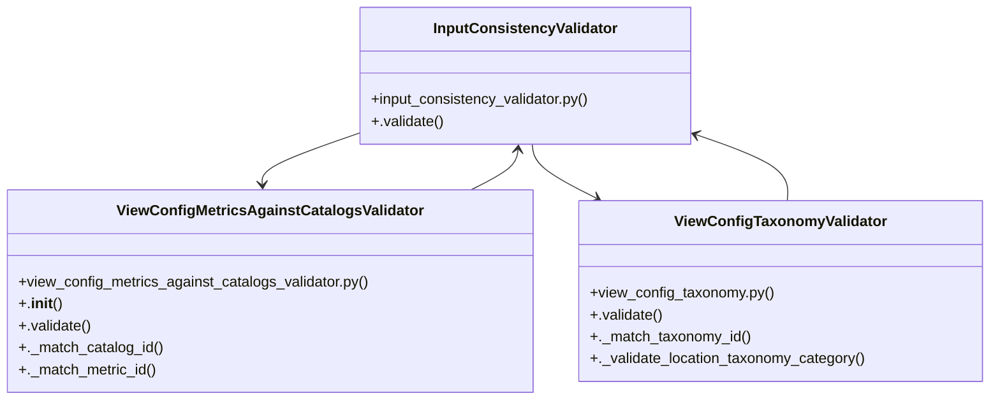

# Community 3

> 56 nodes · cohesion 0.06

## Key Concepts

- [load_view_config()](file:///home/rtei-beg-see-dp/GEMS-DEVELOPMENT/GEMS-ViewsBuilder/gems_views_builder/input/view_config.py#L81) (22 connections)
- [test_view_configs.py](file:///home/rtei-beg-see-dp/GEMS-DEVELOPMENT/GEMS-ViewsBuilder/tests/unit/test_view_configs.py#L1) (14 connections)
- [InputConsistencyValidator](file:///home/rtei-beg-see-dp/GEMS-DEVELOPMENT/GEMS-ViewsBuilder/gems_views_builder/validation/input_consistency_validator.py#L21) (11 connections)
- [ViewConfigMetricsAgainstCatalogsValidator](file:///home/rtei-beg-see-dp/GEMS-DEVELOPMENT/GEMS-ViewsBuilder/gems_views_builder/validation/view_config_metrics_against_catalogs_validator.py#L9) (11 connections)
- [ViewConfigTaxonomyValidator](file:///home/rtei-beg-see-dp/GEMS-DEVELOPMENT/GEMS-ViewsBuilder/gems_views_builder/validation/view_config_taxonomy.py#L14) (10 connections)
- [.validate()](file:///home/rtei-beg-see-dp/GEMS-DEVELOPMENT/GEMS-ViewsBuilder/gems_views_builder/validation/input_consistency_validator.py#L24) (7 connections)
- [write_view_config()](file:///home/rtei-beg-see-dp/GEMS-DEVELOPMENT/GEMS-ViewsBuilder/tests/unit/test_view_configs.py#L38) (7 connections)
- [test_validates_view_configs_with_different_location_categories()](file:///home/rtei-beg-see-dp/GEMS-DEVELOPMENT/GEMS-ViewsBuilder/tests/unit/test_input_consistency_validator.py#L82) (6 connections)
- [make_catalog()](file:///home/rtei-beg-see-dp/GEMS-DEVELOPMENT/GEMS-ViewsBuilder/tests/unit/test_view_configs.py#L135) (6 connections)
- [view_config.py](file:///home/rtei-beg-see-dp/GEMS-DEVELOPMENT/GEMS-ViewsBuilder/gems_views_builder/validation/view_config.py#L1) (5 connections)
- [test_input_consistency_validator.py](file:///home/rtei-beg-see-dp/GEMS-DEVELOPMENT/GEMS-ViewsBuilder/tests/unit/test_input_consistency_validator.py#L1) (5 connections)
- [input_data_direct_validation()](file:///home/rtei-beg-see-dp/GEMS-DEVELOPMENT/GEMS-ViewsBuilder/gems_views_builder/validation/input_validation.py#L16) (5 connections)
- [validate_input_data()](file:///home/rtei-beg-see-dp/GEMS-DEVELOPMENT/GEMS-ViewsBuilder/gems_views_builder/validation/input_validation.py#L11) (5 connections)
- [make_catalog()](file:///home/rtei-beg-see-dp/GEMS-DEVELOPMENT/GEMS-ViewsBuilder/tests/unit/test_input_consistency_validator.py#L17) (5 connections)
- [make_view_config()](file:///home/rtei-beg-see-dp/GEMS-DEVELOPMENT/GEMS-ViewsBuilder/tests/unit/test_input_consistency_validator.py#L34) (5 connections)
- [validate_view_configs_aggregation_patterns()](file:///home/rtei-beg-see-dp/GEMS-DEVELOPMENT/GEMS-ViewsBuilder/gems_views_builder/validation/view_config.py#L23) (5 connections)
- [validate_catalogs()](file:///home/rtei-beg-see-dp/GEMS-DEVELOPMENT/GEMS-ViewsBuilder/gems_views_builder/validation/catalogs.py#L7) (4 connections)
- [test_groups_each_catalog_once_under_the_view_config_that_references_it()](file:///home/rtei-beg-see-dp/GEMS-DEVELOPMENT/GEMS-ViewsBuilder/tests/unit/test_input_consistency_validator.py#L62) (4 connections)
- [test_passes_for_test_dataset()](file:///home/rtei-beg-see-dp/GEMS-DEVELOPMENT/GEMS-ViewsBuilder/tests/unit/test_view_config_taxonomy_validator.py#L13) (4 connections)
- [test_raises_on_id_mismatch()](file:///home/rtei-beg-see-dp/GEMS-DEVELOPMENT/GEMS-ViewsBuilder/tests/unit/test_view_config_taxonomy_validator.py#L22) (4 connections)
- [test_raises_on_unknown_location_category()](file:///home/rtei-beg-see-dp/GEMS-DEVELOPMENT/GEMS-ViewsBuilder/tests/unit/test_view_config_taxonomy_validator.py#L33) (4 connections)
- [test_metrics_validator_raises_when_catalog_is_missing()](file:///home/rtei-beg-see-dp/GEMS-DEVELOPMENT/GEMS-ViewsBuilder/tests/unit/test_view_configs.py#L152) (4 connections)
- [test_metrics_validator_raises_when_metric_is_missing()](file:///home/rtei-beg-see-dp/GEMS-DEVELOPMENT/GEMS-ViewsBuilder/tests/unit/test_view_configs.py#L161) (4 connections)
- [test_view_config_aggregation_patterns_validator_raises_when_time_and_scenario_match()](file:///home/rtei-beg-see-dp/GEMS-DEVELOPMENT/GEMS-ViewsBuilder/tests/unit/test_view_configs.py#L183) (4 connections)
- [validate_view_configs()](file:///home/rtei-beg-see-dp/GEMS-DEVELOPMENT/GEMS-ViewsBuilder/gems_views_builder/validation/view_config.py#L10) (4 connections)
- *... and 31 more nodes in this community*

## Class Diagram

## Relationships

- No strong cross-community connections detected

## Source Files

- [/home/rtei-beg-see-dp/GEMS-DEVELOPMENT/GEMS-ViewsBuilder/gems_views_builder/input/view_config.py](file:///home/rtei-beg-see-dp/GEMS-DEVELOPMENT/GEMS-ViewsBuilder/gems_views_builder/input/view_config.py)
- [/home/rtei-beg-see-dp/GEMS-DEVELOPMENT/GEMS-ViewsBuilder/gems_views_builder/validation/catalogs.py](file:///home/rtei-beg-see-dp/GEMS-DEVELOPMENT/GEMS-ViewsBuilder/gems_views_builder/validation/catalogs.py)
- [/home/rtei-beg-see-dp/GEMS-DEVELOPMENT/GEMS-ViewsBuilder/gems_views_builder/validation/input_consistency_validator.py](file:///home/rtei-beg-see-dp/GEMS-DEVELOPMENT/GEMS-ViewsBuilder/gems_views_builder/validation/input_consistency_validator.py)
- [/home/rtei-beg-see-dp/GEMS-DEVELOPMENT/GEMS-ViewsBuilder/gems_views_builder/validation/input_validation.py](file:///home/rtei-beg-see-dp/GEMS-DEVELOPMENT/GEMS-ViewsBuilder/gems_views_builder/validation/input_validation.py)
- [/home/rtei-beg-see-dp/GEMS-DEVELOPMENT/GEMS-ViewsBuilder/gems_views_builder/validation/view_config.py](file:///home/rtei-beg-see-dp/GEMS-DEVELOPMENT/GEMS-ViewsBuilder/gems_views_builder/validation/view_config.py)
- [/home/rtei-beg-see-dp/GEMS-DEVELOPMENT/GEMS-ViewsBuilder/gems_views_builder/validation/view_config_metrics_against_catalogs_validator.py](file:///home/rtei-beg-see-dp/GEMS-DEVELOPMENT/GEMS-ViewsBuilder/gems_views_builder/validation/view_config_metrics_against_catalogs_validator.py)
- [/home/rtei-beg-see-dp/GEMS-DEVELOPMENT/GEMS-ViewsBuilder/gems_views_builder/validation/view_config_taxonomy.py](file:///home/rtei-beg-see-dp/GEMS-DEVELOPMENT/GEMS-ViewsBuilder/gems_views_builder/validation/view_config_taxonomy.py)
- [/home/rtei-beg-see-dp/GEMS-DEVELOPMENT/GEMS-ViewsBuilder/tests/unit/test_input_consistency_validator.py](file:///home/rtei-beg-see-dp/GEMS-DEVELOPMENT/GEMS-ViewsBuilder/tests/unit/test_input_consistency_validator.py)
- [/home/rtei-beg-see-dp/GEMS-DEVELOPMENT/GEMS-ViewsBuilder/tests/unit/test_view_config_taxonomy_validator.py](file:///home/rtei-beg-see-dp/GEMS-DEVELOPMENT/GEMS-ViewsBuilder/tests/unit/test_view_config_taxonomy_validator.py)
- [/home/rtei-beg-see-dp/GEMS-DEVELOPMENT/GEMS-ViewsBuilder/tests/unit/test_view_configs.py](file:///home/rtei-beg-see-dp/GEMS-DEVELOPMENT/GEMS-ViewsBuilder/tests/unit/test_view_configs.py)

## Audit Trail

- EXTRACTED: 146 (62%)
- INFERRED: 91 (38%)
- AMBIGUOUS: 0 (0%)

---

*Part of the graphify knowledge wiki. See [[index]] to navigate.*