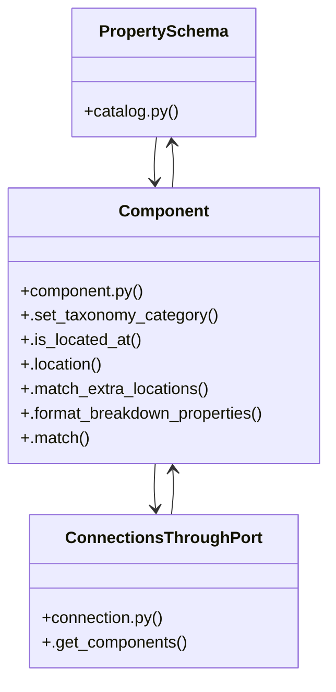

# Community 4

> 52 nodes · cohesion 0.08

## Key Concepts

- [Component](file:///home/rtei-beg-see-dp/GEMS-DEVELOPMENT/GEMS-ViewsBuilder/gems_views_builder/input/component/component.py#L15) (39 connections)
- [test_breakdown_missing_property_keys_use_none_literal()](file:///home/rtei-beg-see-dp/GEMS-DEVELOPMENT/GEMS-ViewsBuilder/tests/test_filtering_and_breakdown_property_order.py#L110) (19 connections)
- [ConnectionsThroughPort](file:///home/rtei-beg-see-dp/GEMS-DEVELOPMENT/GEMS-ViewsBuilder/gems_views_builder/input/component/connection.py#L14) (14 connections)
- [PropertySchema](file:///home/rtei-beg-see-dp/GEMS-DEVELOPMENT/GEMS-ViewsBuilder/gems_views_builder/input/catalog.py#L43) (13 connections)
- [supply_components_with_locations()](file:///home/rtei-beg-see-dp/GEMS-DEVELOPMENT/GEMS-ViewsBuilder/gems_views_builder/input/component/component_factory.py#L110) (10 connections)
- [component_factory.py](file:///home/rtei-beg-see-dp/GEMS-DEVELOPMENT/GEMS-ViewsBuilder/gems_views_builder/input/component/component_factory.py#L1) (9 connections)
- [build_components_by_taxonomy_category()](file:///home/rtei-beg-see-dp/GEMS-DEVELOPMENT/GEMS-ViewsBuilder/tests/unit/test_metric_structure_builder.py#L50) (9 connections)
- [enrich_components()](file:///home/rtei-beg-see-dp/GEMS-DEVELOPMENT/GEMS-ViewsBuilder/gems_views_builder/input/component/component_factory.py#L25) (7 connections)
- [build_components_by_taxon()](file:///home/rtei-beg-see-dp/GEMS-DEVELOPMENT/GEMS-ViewsBuilder/gems_views_builder/__main__.py#L40) (7 connections)
- [build_component_port_connections()](file:///home/rtei-beg-see-dp/GEMS-DEVELOPMENT/GEMS-ViewsBuilder/gems_views_builder/input/component/component_factory.py#L79) (6 connections)
- [group_components_by_taxon()](file:///home/rtei-beg-see-dp/GEMS-DEVELOPMENT/GEMS-ViewsBuilder/gems_views_builder/input/component/component_factory.py#L37) (6 connections)
- [test_input_component.py](file:///home/rtei-beg-see-dp/GEMS-DEVELOPMENT/GEMS-ViewsBuilder/tests/unit/test_input_component.py#L1) (6 connections)
- [make_raw_component()](file:///home/rtei-beg-see-dp/GEMS-DEVELOPMENT/GEMS-ViewsBuilder/tests/unit/test_input_component.py#L13) (6 connections)
- [test_location_none_returns_own_component()](file:///home/rtei-beg-see-dp/GEMS-DEVELOPMENT/GEMS-ViewsBuilder/tests/unit/test_input_component.py#L17) (6 connections)
- [.match_extra_locations()](file:///home/rtei-beg-see-dp/GEMS-DEVELOPMENT/GEMS-ViewsBuilder/gems_views_builder/input/component/component.py#L60) (5 connections)
- [Precompute each component's metric locations from catalog terms.      Must run a](file:///home/rtei-beg-see-dp/GEMS-DEVELOPMENT/GEMS-ViewsBuilder/gems_views_builder/input/component/component_factory.py#L114) (5 connections)
- [Attach taxonomy categories and port connections to components.](file:///home/rtei-beg-see-dp/GEMS-DEVELOPMENT/GEMS-ViewsBuilder/gems_views_builder/input/component/component_factory.py#L26) (5 connections)
- [Group components by taxonomy category. Requires ``supply_components_with_taxon``](file:///home/rtei-beg-see-dp/GEMS-DEVELOPMENT/GEMS-ViewsBuilder/gems_views_builder/input/component/component_factory.py#L38) (5 connections)
- [Return (component_id, port_id) for side `idx` in {1,2}, handling both:     - par](file:///home/rtei-beg-see-dp/GEMS-DEVELOPMENT/GEMS-ViewsBuilder/gems_views_builder/input/component/component_factory.py#L60) (5 connections)
- [One time build which will be used to save information inside component object.](file:///home/rtei-beg-see-dp/GEMS-DEVELOPMENT/GEMS-ViewsBuilder/gems_views_builder/input/component/component_factory.py#L80) (5 connections)
- [supply_components_with_port_connections()](file:///home/rtei-beg-see-dp/GEMS-DEVELOPMENT/GEMS-ViewsBuilder/gems_views_builder/input/component/component_factory.py#L45) (5 connections)
- [supply_components_with_taxon()](file:///home/rtei-beg-see-dp/GEMS-DEVELOPMENT/GEMS-ViewsBuilder/gems_views_builder/input/component/component_factory.py#L32) (5 connections)
- [test_filtering_and_breakdown_property_order.py](file:///home/rtei-beg-see-dp/GEMS-DEVELOPMENT/GEMS-ViewsBuilder/tests/test_filtering_and_breakdown_property_order.py#L1) (5 connections)
- [test_match()](file:///home/rtei-beg-see-dp/GEMS-DEVELOPMENT/GEMS-ViewsBuilder/tests/unit/test_input_component.py#L49) (5 connections)
- [.is_located_at()](file:///home/rtei-beg-see-dp/GEMS-DEVELOPMENT/GEMS-ViewsBuilder/gems_views_builder/input/component/component.py#L47) (4 connections)
- *... and 27 more nodes in this community*

## Class Diagram

## Relationships

- No strong cross-community connections detected

## Source Files

- [/home/rtei-beg-see-dp/GEMS-DEVELOPMENT/GEMS-ViewsBuilder/gems_views_builder/__main__.py](file:///home/rtei-beg-see-dp/GEMS-DEVELOPMENT/GEMS-ViewsBuilder/gems_views_builder/__main__.py)
- [/home/rtei-beg-see-dp/GEMS-DEVELOPMENT/GEMS-ViewsBuilder/gems_views_builder/input/catalog.py](file:///home/rtei-beg-see-dp/GEMS-DEVELOPMENT/GEMS-ViewsBuilder/gems_views_builder/input/catalog.py)
- [/home/rtei-beg-see-dp/GEMS-DEVELOPMENT/GEMS-ViewsBuilder/gems_views_builder/input/component/component.py](file:///home/rtei-beg-see-dp/GEMS-DEVELOPMENT/GEMS-ViewsBuilder/gems_views_builder/input/component/component.py)
- [/home/rtei-beg-see-dp/GEMS-DEVELOPMENT/GEMS-ViewsBuilder/gems_views_builder/input/component/component_factory.py](file:///home/rtei-beg-see-dp/GEMS-DEVELOPMENT/GEMS-ViewsBuilder/gems_views_builder/input/component/component_factory.py)
- [/home/rtei-beg-see-dp/GEMS-DEVELOPMENT/GEMS-ViewsBuilder/gems_views_builder/input/component/connection.py](file:///home/rtei-beg-see-dp/GEMS-DEVELOPMENT/GEMS-ViewsBuilder/gems_views_builder/input/component/connection.py)
- [/home/rtei-beg-see-dp/GEMS-DEVELOPMENT/GEMS-ViewsBuilder/gems_views_builder/input/library.py](file:///home/rtei-beg-see-dp/GEMS-DEVELOPMENT/GEMS-ViewsBuilder/gems_views_builder/input/library.py)
- [/home/rtei-beg-see-dp/GEMS-DEVELOPMENT/GEMS-ViewsBuilder/tests/test_filtering_and_breakdown_property_order.py](file:///home/rtei-beg-see-dp/GEMS-DEVELOPMENT/GEMS-ViewsBuilder/tests/test_filtering_and_breakdown_property_order.py)
- [/home/rtei-beg-see-dp/GEMS-DEVELOPMENT/GEMS-ViewsBuilder/tests/unit/test_input_component.py](file:///home/rtei-beg-see-dp/GEMS-DEVELOPMENT/GEMS-ViewsBuilder/tests/unit/test_input_component.py)
- [/home/rtei-beg-see-dp/GEMS-DEVELOPMENT/GEMS-ViewsBuilder/tests/unit/test_metric_structure_builder.py](file:///home/rtei-beg-see-dp/GEMS-DEVELOPMENT/GEMS-ViewsBuilder/tests/unit/test_metric_structure_builder.py)

## Audit Trail

- EXTRACTED: 120 (43%)
- INFERRED: 162 (57%)
- AMBIGUOUS: 0 (0%)

---

*Part of the graphify knowledge wiki. See [[index]] to navigate.*