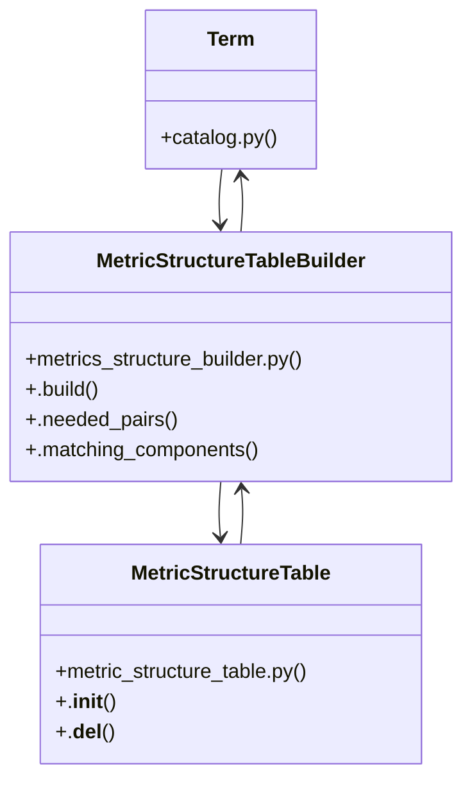

# Community 5

> 47 nodes · cohesion 0.09

## Key Concepts

- [MetricStructureTableBuilder](file:///home/rtei-beg-see-dp/GEMS-DEVELOPMENT/GEMS-ViewsBuilder/gems_views_builder/metrics_structure_builder.py#L15) (26 connections)
- [test_metric_structure_builder.py](file:///home/rtei-beg-see-dp/GEMS-DEVELOPMENT/GEMS-ViewsBuilder/tests/unit/test_metric_structure_builder.py#L1) (23 connections)
- [MetricStructureTable](file:///home/rtei-beg-see-dp/GEMS-DEVELOPMENT/GEMS-ViewsBuilder/gems_views_builder/metric_structure_table.py#L31) (16 connections)
- [Term](file:///home/rtei-beg-see-dp/GEMS-DEVELOPMENT/GEMS-ViewsBuilder/gems_views_builder/input/catalog.py#L78) (14 connections)
- [build()](file:///home/rtei-beg-see-dp/GEMS-DEVELOPMENT/GEMS-ViewsBuilder/tests/unit/test_metric_structure_builder.py#L90) (14 connections)
- [.build()](file:///home/rtei-beg-see-dp/GEMS-DEVELOPMENT/GEMS-ViewsBuilder/gems_views_builder/metrics_structure_builder.py#L19) (8 connections)
- [test_none_location_port_resolves_to_the_component_itself()](file:///home/rtei-beg-see-dp/GEMS-DEVELOPMENT/GEMS-ViewsBuilder/tests/unit/test_metric_structure_builder.py#L301) (8 connections)
- [test_supply_components_with_locations_raises_on_genuine_ambiguity()](file:///home/rtei-beg-see-dp/GEMS-DEVELOPMENT/GEMS-ViewsBuilder/tests/unit/test_metric_structure_builder.py#L265) (8 connections)
- [collect_needed_pairs()](file:///home/rtei-beg-see-dp/GEMS-DEVELOPMENT/GEMS-ViewsBuilder/gems_views_builder/metrics_structure_builder.py#L45) (7 connections)
- [.get_metric()](file:///home/rtei-beg-see-dp/GEMS-DEVELOPMENT/GEMS-ViewsBuilder/gems_views_builder/input/catalog.py#L102) (6 connections)
- [.format_breakdown_properties()](file:///home/rtei-beg-see-dp/GEMS-DEVELOPMENT/GEMS-ViewsBuilder/gems_views_builder/input/component/component.py#L64) (6 connections)
- [(component, output) pairs this metric reads from the simulation table.](file:///home/rtei-beg-see-dp/GEMS-DEVELOPMENT/GEMS-ViewsBuilder/gems_views_builder/metrics_structure_builder.py#L34) (6 connections)
- [Union of (component, output) pairs read by every metric of every view config.](file:///home/rtei-beg-see-dp/GEMS-DEVELOPMENT/GEMS-ViewsBuilder/gems_views_builder/metrics_structure_builder.py#L49) (6 connections)
- [_count_expected_rows()](file:///home/rtei-beg-see-dp/GEMS-DEVELOPMENT/GEMS-ViewsBuilder/tests/unit/test_metric_structure_builder.py#L134) (6 connections)
- [make_component()](file:///home/rtei-beg-see-dp/GEMS-DEVELOPMENT/GEMS-ViewsBuilder/tests/unit/test_metric_structure_builder.py#L99) (6 connections)
- [Match the filter clause against component properties.](file:///home/rtei-beg-see-dp/GEMS-DEVELOPMENT/GEMS-ViewsBuilder/tests/unit/test_metric_structure_builder.py#L125) (6 connections)
- [A port wired to several peers is only ambiguous when more than one of them belon](file:///home/rtei-beg-see-dp/GEMS-DEVELOPMENT/GEMS-ViewsBuilder/tests/unit/test_metric_structure_builder.py#L233) (6 connections)
- [Two peers on the same port both belonging to the term's taxonomy category is an](file:///home/rtei-beg-see-dp/GEMS-DEVELOPMENT/GEMS-ViewsBuilder/tests/unit/test_metric_structure_builder.py#L266) (6 connections)
- [A location_port resolves to its connected peer component.](file:///home/rtei-beg-see-dp/GEMS-DEVELOPMENT/GEMS-ViewsBuilder/tests/unit/test_metric_structure_builder.py#L290) (6 connections)
- [A term with location_port=None means the component is its own location.      Sel](file:///home/rtei-beg-see-dp/GEMS-DEVELOPMENT/GEMS-ViewsBuilder/tests/unit/test_metric_structure_builder.py#L302) (6 connections)
- [test_single_port_multiple_peers_of_other_categories_are_skipped_not_raised()](file:///home/rtei-beg-see-dp/GEMS-DEVELOPMENT/GEMS-ViewsBuilder/tests/unit/test_metric_structure_builder.py#L230) (6 connections)
- [.location()](file:///home/rtei-beg-see-dp/GEMS-DEVELOPMENT/GEMS-ViewsBuilder/gems_views_builder/input/component/component.py#L57) (5 connections)
- [.matching_components()](file:///home/rtei-beg-see-dp/GEMS-DEVELOPMENT/GEMS-ViewsBuilder/gems_views_builder/metrics_structure_builder.py#L37) (5 connections)
- [_component_matches_filters()](file:///home/rtei-beg-see-dp/GEMS-DEVELOPMENT/GEMS-ViewsBuilder/tests/unit/test_metric_structure_builder.py#L124) (5 connections)
- [make_view_config()](file:///home/rtei-beg-see-dp/GEMS-DEVELOPMENT/GEMS-ViewsBuilder/tests/unit/test_metric_structure_builder.py#L40) (5 connections)
- *... and 22 more nodes in this community*

## Class Diagram

## Relationships

- No strong cross-community connections detected

## Source Files

- [/home/rtei-beg-see-dp/GEMS-DEVELOPMENT/GEMS-ViewsBuilder/gems_views_builder/input/catalog.py](file:///home/rtei-beg-see-dp/GEMS-DEVELOPMENT/GEMS-ViewsBuilder/gems_views_builder/input/catalog.py)
- [/home/rtei-beg-see-dp/GEMS-DEVELOPMENT/GEMS-ViewsBuilder/gems_views_builder/input/component/component.py](file:///home/rtei-beg-see-dp/GEMS-DEVELOPMENT/GEMS-ViewsBuilder/gems_views_builder/input/component/component.py)
- [/home/rtei-beg-see-dp/GEMS-DEVELOPMENT/GEMS-ViewsBuilder/gems_views_builder/metric_structure_table.py](file:///home/rtei-beg-see-dp/GEMS-DEVELOPMENT/GEMS-ViewsBuilder/gems_views_builder/metric_structure_table.py)
- [/home/rtei-beg-see-dp/GEMS-DEVELOPMENT/GEMS-ViewsBuilder/gems_views_builder/metrics_structure_builder.py](file:///home/rtei-beg-see-dp/GEMS-DEVELOPMENT/GEMS-ViewsBuilder/gems_views_builder/metrics_structure_builder.py)
- [/home/rtei-beg-see-dp/GEMS-DEVELOPMENT/GEMS-ViewsBuilder/tests/unit/test_metric_structure_builder.py](file:///home/rtei-beg-see-dp/GEMS-DEVELOPMENT/GEMS-ViewsBuilder/tests/unit/test_metric_structure_builder.py)

## Audit Trail

- EXTRACTED: 145 (53%)
- INFERRED: 130 (47%)
- AMBIGUOUS: 0 (0%)

---

*Part of the graphify knowledge wiki. See [[index]] to navigate.*