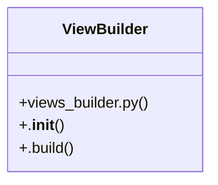

# Community 6

> 41 nodes · cohesion 0.10

## Key Concepts

- [test_run_view_building_leads_to_generate_one_view_per_aggregation_pattern()](file:///home/rtei-beg-see-dp/GEMS-DEVELOPMENT/GEMS-ViewsBuilder/tests/e2e/test_aggregation_patterns.py#L128) (14 connections)
- [.build()](file:///home/rtei-beg-see-dp/GEMS-DEVELOPMENT/GEMS-ViewsBuilder/gems_views_builder/view/views_builder.py#L23) (12 connections)
- [test_extra_locations_values_in_final_metric_views()](file:///home/rtei-beg-see-dp/GEMS-DEVELOPMENT/GEMS-ViewsBuilder/tests/e2e/test_spatial_aggregation_e2e.py#L178) (11 connections)
- [test_extra_locations.py](file:///home/rtei-beg-see-dp/GEMS-DEVELOPMENT/GEMS-ViewsBuilder/tests/unit/test_extra_locations.py#L1) (9 connections)
- [build_input()](file:///home/rtei-beg-see-dp/GEMS-DEVELOPMENT/GEMS-ViewsBuilder/tests/e2e/test_aggregation_patterns.py#L98) (9 connections)
- [build_input()](file:///home/rtei-beg-see-dp/GEMS-DEVELOPMENT/GEMS-ViewsBuilder/tests/e2e/test_spatial_aggregation_e2e.py#L113) (9 connections)
- [test_aggregation_patterns.py](file:///home/rtei-beg-see-dp/GEMS-DEVELOPMENT/GEMS-ViewsBuilder/tests/e2e/test_aggregation_patterns.py#L1) (8 connections)
- [test_spatial_aggregation_e2e.py](file:///home/rtei-beg-see-dp/GEMS-DEVELOPMENT/GEMS-ViewsBuilder/tests/e2e/test_spatial_aggregation_e2e.py#L1) (8 connections)
- [utils.py](file:///home/rtei-beg-see-dp/GEMS-DEVELOPMENT/GEMS-ViewsBuilder/tests/e2e/utils.py#L1) (8 connections)
- [ViewBuilder](file:///home/rtei-beg-see-dp/GEMS-DEVELOPMENT/GEMS-ViewsBuilder/gems_views_builder/view/views_builder.py#L16) (8 connections)
- [make_metric()](file:///home/rtei-beg-see-dp/GEMS-DEVELOPMENT/GEMS-ViewsBuilder/tests/unit/test_extra_locations.py#L23) (7 connections)
- [make_view_config()](file:///home/rtei-beg-see-dp/GEMS-DEVELOPMENT/GEMS-ViewsBuilder/tests/unit/test_extra_locations.py#L32) (7 connections)
- [make_component()](file:///home/rtei-beg-see-dp/GEMS-DEVELOPMENT/GEMS-ViewsBuilder/tests/unit/test_extra_locations.py#L13) (6 connections)
- [test_located_component_emits_primary_and_extra_locations()](file:///home/rtei-beg-see-dp/GEMS-DEVELOPMENT/GEMS-ViewsBuilder/tests/unit/test_extra_locations.py#L100) (6 connections)
- [test_missing_extra_properties_keeps_primary_only()](file:///home/rtei-beg-see-dp/GEMS-DEVELOPMENT/GEMS-ViewsBuilder/tests/unit/test_extra_locations.py#L140) (6 connections)
- [test_no_extra_locations_keeps_primary_only()](file:///home/rtei-beg-see-dp/GEMS-DEVELOPMENT/GEMS-ViewsBuilder/tests/unit/test_extra_locations.py#L123) (6 connections)
- [test_partial_extra_locations_emits_only_present_ones()](file:///home/rtei-beg-see-dp/GEMS-DEVELOPMENT/GEMS-ViewsBuilder/tests/unit/test_extra_locations.py#L158) (6 connections)
- [make_metrics()](file:///home/rtei-beg-see-dp/GEMS-DEVELOPMENT/GEMS-ViewsBuilder/tests/e2e/test_spatial_aggregation_e2e.py#L61) (5 connections)
- [make_metrics()](file:///home/rtei-beg-see-dp/GEMS-DEVELOPMENT/GEMS-ViewsBuilder/tests/e2e/test_aggregation_patterns.py#L60) (4 connections)
- [make_system()](file:///home/rtei-beg-see-dp/GEMS-DEVELOPMENT/GEMS-ViewsBuilder/tests/e2e/test_aggregation_patterns.py#L50) (4 connections)
- [make_system()](file:///home/rtei-beg-see-dp/GEMS-DEVELOPMENT/GEMS-ViewsBuilder/tests/e2e/test_spatial_aggregation_e2e.py#L49) (4 connections)
- [make_view_config()](file:///home/rtei-beg-see-dp/GEMS-DEVELOPMENT/GEMS-ViewsBuilder/tests/e2e/test_spatial_aggregation_e2e.py#L78) (4 connections)
- [make_calendar()](file:///home/rtei-beg-see-dp/GEMS-DEVELOPMENT/GEMS-ViewsBuilder/tests/e2e/utils.py#L60) (4 connections)
- [make_simulation_table()](file:///home/rtei-beg-see-dp/GEMS-DEVELOPMENT/GEMS-ViewsBuilder/tests/e2e/utils.py#L41) (4 connections)
- [make_catalogs()](file:///home/rtei-beg-see-dp/GEMS-DEVELOPMENT/GEMS-ViewsBuilder/tests/e2e/test_aggregation_patterns.py#L86) (3 connections)
- *... and 16 more nodes in this community*

## Class Diagram

## Relationships

- No strong cross-community connections detected

## Source Files

- [/home/rtei-beg-see-dp/GEMS-DEVELOPMENT/GEMS-ViewsBuilder/gems_views_builder/view/views_builder.py](file:///home/rtei-beg-see-dp/GEMS-DEVELOPMENT/GEMS-ViewsBuilder/gems_views_builder/view/views_builder.py)
- [/home/rtei-beg-see-dp/GEMS-DEVELOPMENT/GEMS-ViewsBuilder/tests/e2e/test_aggregation_patterns.py](file:///home/rtei-beg-see-dp/GEMS-DEVELOPMENT/GEMS-ViewsBuilder/tests/e2e/test_aggregation_patterns.py)
- [/home/rtei-beg-see-dp/GEMS-DEVELOPMENT/GEMS-ViewsBuilder/tests/e2e/test_spatial_aggregation_e2e.py](file:///home/rtei-beg-see-dp/GEMS-DEVELOPMENT/GEMS-ViewsBuilder/tests/e2e/test_spatial_aggregation_e2e.py)
- [/home/rtei-beg-see-dp/GEMS-DEVELOPMENT/GEMS-ViewsBuilder/tests/e2e/utils.py](file:///home/rtei-beg-see-dp/GEMS-DEVELOPMENT/GEMS-ViewsBuilder/tests/e2e/utils.py)
- [/home/rtei-beg-see-dp/GEMS-DEVELOPMENT/GEMS-ViewsBuilder/tests/unit/test_extra_locations.py](file:///home/rtei-beg-see-dp/GEMS-DEVELOPMENT/GEMS-ViewsBuilder/tests/unit/test_extra_locations.py)

## Audit Trail

- EXTRACTED: 127 (61%)
- INFERRED: 80 (39%)
- AMBIGUOUS: 0 (0%)

---

*Part of the graphify knowledge wiki. See [[index]] to navigate.*