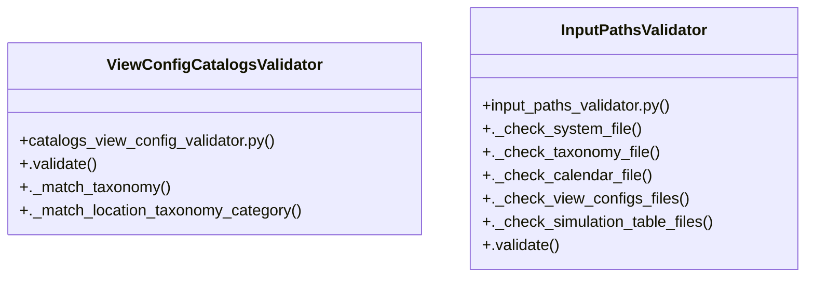

# Community 7

> 40 nodes · cohesion 0.13

## Key Concepts

- [.validate()](file:///home/rtei-beg-see-dp/GEMS-DEVELOPMENT/GEMS-ViewsBuilder/gems_views_builder/validation/catalogs_view_config_validator.py#L15) (32 connections)
- [InputPathsValidator](file:///home/rtei-beg-see-dp/GEMS-DEVELOPMENT/GEMS-ViewsBuilder/gems_views_builder/validation/input_paths_validator.py#L16) (28 connections)
- [write_minimal_input_data_set()](file:///home/rtei-beg-see-dp/GEMS-DEVELOPMENT/GEMS-ViewsBuilder/tests/unit/test_views_input_checks.py#L15) (17 connections)
- [test_views_input_checks.py](file:///home/rtei-beg-see-dp/GEMS-DEVELOPMENT/GEMS-ViewsBuilder/tests/unit/test_views_input_checks.py#L1) (16 connections)
- [ViewConfigCatalogsValidator](file:///home/rtei-beg-see-dp/GEMS-DEVELOPMENT/GEMS-ViewsBuilder/gems_views_builder/validation/catalogs_view_config_validator.py#L11) (11 connections)
- [require_suffix()](file:///home/rtei-beg-see-dp/GEMS-DEVELOPMENT/GEMS-ViewsBuilder/gems_views_builder/validation/input_paths_validator.py#L61) (7 connections)
- [.validate()](file:///home/rtei-beg-see-dp/GEMS-DEVELOPMENT/GEMS-ViewsBuilder/gems_views_builder/validation/input_paths_validator.py#L51) (6 connections)
- [test_passes_for_loaded_catalogs()](file:///home/rtei-beg-see-dp/GEMS-DEVELOPMENT/GEMS-ViewsBuilder/tests/unit/test_catalogs_view_config_validator.py#L14) (6 connections)
- [load_catalogs()](file:///home/rtei-beg-see-dp/GEMS-DEVELOPMENT/GEMS-ViewsBuilder/gems_views_builder/input/catalog.py#L131) (5 connections)
- [test_passes_for_loaded_catalogs()](file:///home/rtei-beg-see-dp/GEMS-DEVELOPMENT/GEMS-ViewsBuilder/tests/unit/test_catalogs_taxonomy_validator.py#L14) (5 connections)
- [test_raises_on_location_category_mismatch()](file:///home/rtei-beg-see-dp/GEMS-DEVELOPMENT/GEMS-ViewsBuilder/tests/unit/test_catalogs_view_config_validator.py#L33) (5 connections)
- [test_raises_on_taxonomy_id_mismatch()](file:///home/rtei-beg-see-dp/GEMS-DEVELOPMENT/GEMS-ViewsBuilder/tests/unit/test_catalogs_view_config_validator.py#L22) (5 connections)
- [._check_simulation_table_files()](file:///home/rtei-beg-see-dp/GEMS-DEVELOPMENT/GEMS-ViewsBuilder/gems_views_builder/validation/input_paths_validator.py#L39) (4 connections)
- [test_rejects_invalid_references()](file:///home/rtei-beg-see-dp/GEMS-DEVELOPMENT/GEMS-ViewsBuilder/tests/unit/test_catalogs_taxonomy_validator.py#L32) (4 connections)
- [test_non_yml_catalog_files_are_not_collected()](file:///home/rtei-beg-see-dp/GEMS-DEVELOPMENT/GEMS-ViewsBuilder/tests/unit/test_views_input_checks.py#L79) (4 connections)
- [test_non_yml_library_files_are_not_collected()](file:///home/rtei-beg-see-dp/GEMS-DEVELOPMENT/GEMS-ViewsBuilder/tests/unit/test_views_input_checks.py#L46) (4 connections)
- [test_validate_passes_for_minimal_valid_paths()](file:///home/rtei-beg-see-dp/GEMS-DEVELOPMENT/GEMS-ViewsBuilder/tests/unit/test_views_input_checks.py#L42) (4 connections)
- [test_validate_passes_when_simulation_table_is_csv()](file:///home/rtei-beg-see-dp/GEMS-DEVELOPMENT/GEMS-ViewsBuilder/tests/unit/test_views_input_checks.py#L161) (4 connections)
- [test_validate_passes_with_arbitrarily_named_catalog_file()](file:///home/rtei-beg-see-dp/GEMS-DEVELOPMENT/GEMS-ViewsBuilder/tests/unit/test_views_input_checks.py#L101) (4 connections)
- [test_validate_passes_with_arbitrarily_named_model_library_file()](file:///home/rtei-beg-see-dp/GEMS-DEVELOPMENT/GEMS-ViewsBuilder/tests/unit/test_views_input_checks.py#L68) (4 connections)
- [test_validate_passes_with_multiple_catalogs()](file:///home/rtei-beg-see-dp/GEMS-DEVELOPMENT/GEMS-ViewsBuilder/tests/unit/test_views_input_checks.py#L90) (4 connections)
- [test_validate_passes_with_multiple_model_libraries()](file:///home/rtei-beg-see-dp/GEMS-DEVELOPMENT/GEMS-ViewsBuilder/tests/unit/test_views_input_checks.py#L57) (4 connections)
- [test_validate_raises_when_calendar_has_wrong_extension()](file:///home/rtei-beg-see-dp/GEMS-DEVELOPMENT/GEMS-ViewsBuilder/tests/unit/test_views_input_checks.py#L119) (4 connections)
- [test_validate_raises_when_simulation_table_has_wrong_extension()](file:///home/rtei-beg-see-dp/GEMS-DEVELOPMENT/GEMS-ViewsBuilder/tests/unit/test_views_input_checks.py#L140) (4 connections)
- [test_validate_raises_when_simulation_tables_are_missing()](file:///home/rtei-beg-see-dp/GEMS-DEVELOPMENT/GEMS-ViewsBuilder/tests/unit/test_views_input_checks.py#L147) (4 connections)
- *... and 15 more nodes in this community*

## Class Diagram

## Relationships

- No strong cross-community connections detected

## Source Files

- [/home/rtei-beg-see-dp/GEMS-DEVELOPMENT/GEMS-ViewsBuilder/gems_views_builder/input/catalog.py](file:///home/rtei-beg-see-dp/GEMS-DEVELOPMENT/GEMS-ViewsBuilder/gems_views_builder/input/catalog.py)
- [/home/rtei-beg-see-dp/GEMS-DEVELOPMENT/GEMS-ViewsBuilder/gems_views_builder/validation/catalogs_view_config_validator.py](file:///home/rtei-beg-see-dp/GEMS-DEVELOPMENT/GEMS-ViewsBuilder/gems_views_builder/validation/catalogs_view_config_validator.py)
- [/home/rtei-beg-see-dp/GEMS-DEVELOPMENT/GEMS-ViewsBuilder/gems_views_builder/validation/input_paths_validator.py](file:///home/rtei-beg-see-dp/GEMS-DEVELOPMENT/GEMS-ViewsBuilder/gems_views_builder/validation/input_paths_validator.py)
- [/home/rtei-beg-see-dp/GEMS-DEVELOPMENT/GEMS-ViewsBuilder/tests/unit/test_catalogs_taxonomy_validator.py](file:///home/rtei-beg-see-dp/GEMS-DEVELOPMENT/GEMS-ViewsBuilder/tests/unit/test_catalogs_taxonomy_validator.py)
- [/home/rtei-beg-see-dp/GEMS-DEVELOPMENT/GEMS-ViewsBuilder/tests/unit/test_catalogs_view_config_validator.py](file:///home/rtei-beg-see-dp/GEMS-DEVELOPMENT/GEMS-ViewsBuilder/tests/unit/test_catalogs_view_config_validator.py)
- [/home/rtei-beg-see-dp/GEMS-DEVELOPMENT/GEMS-ViewsBuilder/tests/unit/test_views_input_checks.py](file:///home/rtei-beg-see-dp/GEMS-DEVELOPMENT/GEMS-ViewsBuilder/tests/unit/test_views_input_checks.py)

## Audit Trail

- EXTRACTED: 124 (52%)
- INFERRED: 113 (48%)
- AMBIGUOUS: 0 (0%)

---

*Part of the graphify knowledge wiki. See [[index]] to navigate.*