# InputPathsValidator

> God node · 28 connections · [/home/rtei-beg-see-dp/GEMS-DEVELOPMENT/GEMS-ViewsBuilder/gems_views_builder/validation/input_paths_validator.py](file:///home/rtei-beg-see-dp/GEMS-DEVELOPMENT/GEMS-ViewsBuilder/gems_views_builder/validation/input_paths_validator.py#L16)

## Call Trace Diagram

```mermaid
sequenceDiagram
    participant P0 as InputPathsValidator
    participant P1 as InputPaths
    participant P2 as write_minimal_input_data_set()
    participant P3 as test_validate_passes_for_minimal_valid_paths()
    participant P4 as test_non_yml_library_files_are_not_collected()
    participant P5 as test_validate_passes_with_multiple_model_libraries()
    participant P6 as test_validate_passes_with_arbitrarily_named_model_library_file()
    participant P7 as test_non_yml_catalog_files_are_not_collected()
    participant P8 as test_validate_passes_with_multiple_catalogs()
    participant P9 as test_validate_passes_with_arbitrarily_named_catalog_file()
    participant P10 as test_validate_raises_when_system_has_wrong_extension()
    participant P11 as test_validate_raises_when_calendar_has_wrong_extension()
    participant P12 as test_validate_raises_when_taxonomy_has_wrong_extension()
    participant P13 as test_validate_raises_when_view_config_has_wrong_extension()
    participant P14 as test_validate_raises_when_simulation_table_has_wrong_extension()
    participant P15 as test_validate_raises_when_simulation_tables_are_missing()
    participant P16 as test_validate_raises_when_simulation_tables_have_different_extensions()
    participant P17 as test_validate_passes_when_simulation_table_is_csv()
    participant P18 as paths_from_dataset()
    participant P19 as main()
    participant P20 as Constructor should not read yaml or parquet.     Multi-file inputs are resolved
    participant P21 as Loader
    participant P22 as test_loader_init_has_no_io()
    participant P23 as Configure logging once for the whole test session (file + console handlers).
    participant P24 as Build InputPaths from a flat test dataset directory.
    participant P25 as Perform all input data I/O and return the loaded raw input data.
    participant P26 as Validates InputPaths shapes (extensions / expected contents).      Existence of
    participant P27 as is_valid_dataset_dir()
    P0->>+ P1: uses
    P1-->>- P0: return
    P1->>+ P0: uses
    P0-->>- P1: return
    P1->>+ P2: calls
    P2-->>- P1: return
    P2->>+ P1: calls
    P1-->>- P2: return
    P2->>+ P3: calls
    P3-->>- P2: return
    P2->>+ P4: calls
    P4-->>- P2: return
    P2->>+ P5: calls
    P5-->>- P2: return
    P2->>+ P6: calls
    P6-->>- P2: return
    P2->>+ P7: calls
    P7-->>- P2: return
    P2->>+ P8: calls
    P8-->>- P2: return
    P2->>+ P9: calls
    P9-->>- P2: return
    P2->>+ P10: calls
    P10-->>- P2: return
    P2->>+ P11: calls
    P11-->>- P2: return
    P2->>+ P12: calls
    P12-->>- P2: return
    P2->>+ P13: calls
    P13-->>- P2: return
    P2->>+ P14: calls
    P14-->>- P2: return
    P2->>+ P15: calls
    P15-->>- P2: return
    P2->>+ P16: calls
    P16-->>- P2: return
    P2->>+ P17: calls
    P17-->>- P2: return
    P1->>+ P18: calls
    P18-->>- P1: return
    P1->>+ P19: calls
    P19-->>- P1: return
    P1->>+ P20: uses
    P20-->>- P1: return
    P1->>+ P21: uses
    P21-->>- P1: return
    P1->>+ P22: calls
    P22-->>- P1: return
    P1->>+ P23: uses
    P23-->>- P1: return
    P1->>+ P24: uses
    P24-->>- P1: return
    P1->>+ P25: uses
    P25-->>- P1: return
    P1->>+ P26: uses
    P26-->>- P1: return
    P0->>+ P19: calls
    P19-->>- P0: return
    P0->>+ P27: calls
    P27-->>- P0: return
    P0->>+ P3: calls
    P3-->>- P0: return
    P0->>+ P4: calls
    P4-->>- P0: return
    P0->>+ P5: calls
    P5-->>- P0: return
    P0->>+ P6: calls
    P6-->>- P0: return
    P0->>+ P7: calls
    P7-->>- P0: return
    P0->>+ P8: calls
    P8-->>- P0: return
    P0->>+ P9: calls
    P9-->>- P0: return
    P0->>+ P10: calls
    P10-->>- P0: return
    P0->>+ P11: calls
    P11-->>- P0: return
    P0->>+ P12: calls
    P12-->>- P0: return
    P0->>+ P13: calls
    P13-->>- P0: return
    P0->>+ P14: calls
    P14-->>- P0: return
    P0->>+ P15: calls
    P15-->>- P0: return
    P0->>+ P16: calls
    P16-->>- P0: return
    P0->>+ P17: calls
    P17-->>- P0: return
    P0->>+ P23: uses
    P23-->>- P0: return
    P0->>+ P24: uses
    P24-->>- P0: return
```

## Connections by Relation

### calls
- [[main()]] `INFERRED`
- [[is_valid_dataset_dir()]] `INFERRED`
- [[test_validate_passes_for_minimal_valid_paths()]] `INFERRED`
- [[test_non_yml_library_files_are_not_collected()]] `INFERRED`
- [[test_validate_passes_with_multiple_model_libraries()]] `INFERRED`
- [[test_validate_passes_with_arbitrarily_named_model_library_file()]] `INFERRED`
- [[test_non_yml_catalog_files_are_not_collected()]] `INFERRED`
- [[test_validate_passes_with_multiple_catalogs()]] `INFERRED`
- [[test_validate_passes_with_arbitrarily_named_catalog_file()]] `INFERRED`
- [[test_validate_raises_when_system_has_wrong_extension()]] `INFERRED`
- [[test_validate_raises_when_calendar_has_wrong_extension()]] `INFERRED`
- [[test_validate_raises_when_taxonomy_has_wrong_extension()]] `INFERRED`
- [[test_validate_raises_when_view_config_has_wrong_extension()]] `INFERRED`
- [[test_validate_raises_when_simulation_table_has_wrong_extension()]] `INFERRED`
- [[test_validate_raises_when_simulation_tables_are_missing()]] `INFERRED`
- [[test_validate_raises_when_simulation_tables_have_different_extensions()]] `INFERRED`
- [[test_validate_passes_when_simulation_table_is_csv()]] `INFERRED`

### contains
- [[input_paths_validator.py]] `EXTRACTED`

### method
- [[.validate()]] `EXTRACTED`
- [[._check_simulation_table_files()]] `EXTRACTED`
- [[._check_system_file()]] `EXTRACTED`
- [[._check_taxonomy_file()]] `EXTRACTED`
- [[._check_calendar_file()]] `EXTRACTED`
- [[._check_view_configs_files()]] `EXTRACTED`

### rationale_for
- [[Validates InputPaths shapes (extensions / expected contents).      Existence of]] `EXTRACTED`

### uses
- [[InputPaths]] `INFERRED`
- [[Configure logging once for the whole test session (file + console handlers).]] `INFERRED`
- [[Build InputPaths from a flat test dataset directory.]] `INFERRED`

---

*Part of the graphify knowledge wiki. See [[index]] to navigate.*