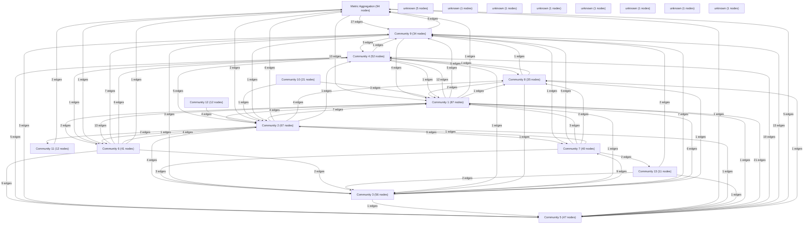

# Knowledge Graph Index

> Auto-generated by graphify. Start here — read community articles for context, then drill into god nodes for detail.

**621 nodes · 1547 edges · 22 communities**

---

## System Architecture Flowchart

## Communities
(sorted by size, largest first)

- [[Metric Aggregation]] — 94 nodes
- [[Community 1]] — 87 nodes
- [[Community 2]] — 67 nodes
- [[Community 3]] — 56 nodes
- [[Community 4]] — 52 nodes
- [[Community 5]] — 47 nodes
- [[Community 6]] — 41 nodes
- [[Community 7]] — 40 nodes
- [[Community 8]] — 35 nodes
- [[Community 9]] — 34 nodes
- [[Community 10]] — 21 nodes
- [[Community 11]] — 12 nodes
- [[Community 12]] — 12 nodes
- [[Community 13]] — 11 nodes
- [[unknown]] — 5 nodes
- [[unknown]] — 1 nodes
- [[unknown]] — 1 nodes
- [[unknown]] — 1 nodes
- [[unknown]] — 1 nodes
- [[unknown]] — 1 nodes
- [[unknown]] — 1 nodes
- [[unknown]] — 1 nodes

## God Nodes
(most connected concepts — the load-bearing abstractions)

- [[ViewConfig]] — 42 connections
- [[Component]] — 39 connections
- [[Metric]] — 36 connections
- [[InputPathsValidator]] — 28 connections
- [[AggregationPattern]] — 27 connections
- [[MetricStructureTableBuilder]] — 26 connections
- [[Catalog]] — 24 connections
- [[SimulationTable]] — 23 connections
- [[TemporalMetricView]] — 22 connections
- [[RawInputData]] — 22 connections

---

*Generated by [graphify](https://github.com/safishamsi/graphify)*